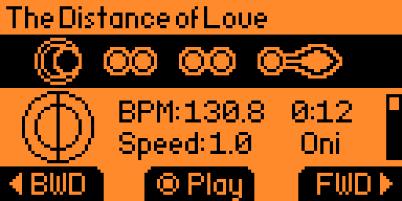

# Flipper Zero Taiko Player

[简体中文](README.md) | [English](README.en.md)


A lightweight TJA player for Flipper Zero. Choose a chart from the SD card, play backing audio and drum sounds through the built-in speaker, and watch the scrolling notes. Optional GPIO outputs provide four channels of drum-hit pulses.



## Features

- Normal and big Don/Ka notes, drumrolls, balloons, per-note scroll speed (`#SCROLL`), and GOGO TIME effects.
- Automatic drum-sound mixing and alternating left/right drum indicators.
- Difficulty selection, pause, seeking, and separate playback speed, scroll speed, and volume controls.
- Four configurable GPIO outputs, disabled by default, with saved preferences.
- Separate builds for official firmware and Momentum.

This is a chart player; hit judgment is not implemented. Convert OGG audio to PCM WAV on your computer before playback.

## Quick start

1. Download the package matching your firmware from [GitHub Releases](https://github.com/ZeroNinx/flipper-zero-taiko-player/releases). The v0.3 builds use official firmware 1.5.1 (API 88.2) and Momentum mntm-009 (API 79.2).
2. Extract the archive and copy the contents of `sdcard/` to the root of your SD card. Packages include the app, drum sounds, and conversion scripts, but no songs or personal settings.
3. Install Python 3 and FFmpeg on your computer. Place your TJA files and matching audio in the extracted `songs/` folder, keeping the audio paths specified by each chart's `WAVE:` field. For example:

   ```text
   songs/
     Example Song/
       chart.tja
       song.ogg
   ```

   From the extracted package directory, run:

   ```sh
   python3 scripts/prepare_songs.py songs --output sdcard/apps_data/taiko_player/songs
   ```

   This creates UTF-8 chart copies and 22050 Hz, unsigned 8-bit mono PCM WAV files, updating the copied charts' `WAVE:` fields. Your originals are preserved.
4. Copy the generated `sdcard/apps_data/taiko_player/songs/` to the same location on the SD card.
5. On your Flipper, open **Media → Taiko Player** and select a `.tja` file.

To upgrade, replace the app and drum-sound files while keeping your songs and `settings.ff`. Release packages do not require a build environment.

## Prepare drum sounds separately

If you install the app without a Release ZIP, drum sounds need to be uploaded separately. Download the [source archive](https://github.com/ZeroNinx/flipper-zero-taiko-player/archive/refs/heads/main.zip), extract it, and run this command from its root directory with Python 3 and FFmpeg installed:

```sh
python3 scripts/prepare_sfx.py
```

Copy the generated sdcard/apps_data/taiko_player/sfx/ folder, including its license and attribution files, to the same location on the SD card. Restart the app to load the sounds. No uFBT setup is needed for conversion; without these optional sounds, backing audio still plays.

## Controls

| Button | Action |
| --- | --- |
| OK | Play / pause; replay after the song ends |
| Left / Right | Seek backward / forward; 5 seconds by default |
| Up / Down | Adjust app volume; hold to repeat |
| Short Back | Open the menu / return |
| Hold Back during playback | Exit the app |

In the menu, use Up/Down to select, Left/Right to adjust, and OK to activate. Opening the menu pauses playback. **Return** resumes the previous state; **Restart** starts over; **Play New Song** opens the song browser.

Difficulty defaults to Oni, or the highest available course when Oni is absent. Playback speed ranges from **0.5× to 2.0×** in 0.1 steps and changes pitch. Scroll speed is independent: **0.5× to 2.5×** in 0.1 steps, plus **3.0× and 4.0×**. **Frame Rate**, below Scroll Speed, sets the target display refresh rate from **15 to 60 FPS** in 1 FPS steps (default: **50 FPS**), without changing audio or hit scheduling. Volume, speeds, frame rate, seek intervals, and GPIO pin mappings are saved in `/ext/apps_data/taiko_player/settings.ff`; GPIO output starts disabled each time.

GPIO uses 3.3 V logic and 70 ms high pulses; connect the receiver to Flipper's GND. The default mapping is **Left Ka → A7, Left Don → A6, Right Don → A4, Right Ka → B3**. Configure it under **GPIO Setting** and enable it with **GPIO Output**.

## Documentation

Detailed guides are currently in Chinese:

- [User guide](docs/usage.md): installation, song conversion, menus, audio, GPIO, and saved settings.
- [Chart support](docs/chart-support.md): note rendering, scroll behavior, rolls, balloons, GOGO TIME, and format limits.
- [Development guide](docs/development.md): builds, tests, packaging, resource management, and references.
- [Release history](https://github.com/ZeroNinx/flipper-zero-taiko-player/releases): downloads and release notes.
- [Catalog submission](docs/catalog-submission.md): catalog metadata, validation, and submission steps (Chinese).

Branching charts, Dan courses, pitch-preserving playback speed changes, and precise synchronization are not supported. Audio must be unsigned 8-bit mono PCM WAV at 8000–48000 Hz; the device does not decode OGG directly.

## Build from source

Requires Python 3, Make, FFmpeg, and network access to download the uFBT SDK and toolchain. Local tests also require a C compiler with AddressSanitizer and UndefinedBehaviorSanitizer support. Commands below target Linux / macOS.

```sh
git clone https://github.com/ZeroNinx/flipper-zero-taiko-player.git
cd flipper-zero-taiko-player
make setup
make build
```

The official build is saved to `dist/official/taiko_player.fap`. For Momentum, initialize its separate SDK and build:

```sh
make momentum-sdk
make build FIRMWARE=momentum
```

The Momentum build is saved to `dist/momentum/taiko_player.fap`. Use an SDK compatible with your device's firmware API. Run `make test` for local tests.

## Credits

The default Don/Ka sounds come from TJAPlayer3's SimpleStyle skin under the MIT license. See [sound attribution and license](assets/SFX-NOTICE.md).

## License

The project code and original icons are licensed under [GPL-3.0-or-later](LICENSE). Third-party drum sounds retain their MIT license and copyright notice.

## AI collaboration

This project was created by the author in collaboration with **GPT-6.1-sol**. AI contributed to implementation, testing, and documentation; the author provided requirements, reviewed decisions, and tested the app on hardware.

Bring a TJA chart to life on a little dolphin.
