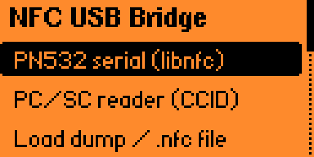
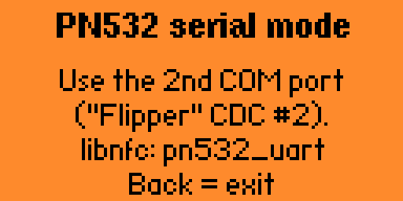

# NFC USB Bridge for Flipper Zero

Turns the Flipper into a USB NFC reader/writer for your PC, two ways. The card the PC sees is either one
you hold to the Flipper, or **one you load from a dump / `.nfc` file** (see below):

<p align="center">
  
  
</p>

| Mode | PC sees | Use with |
|---|---|---|
| **PN532 serial** | a second COM port speaking the PN532 protocol | libnfc (`nfc-list`, `nfc-mfclassic`, `nfc-mfultralight`), libfreefare, nfcpy |
| **PC/SC reader** | a USB CCID smart-card reader | `pcsc_scan`, `opensc`, Python `pyscard`, any PC/SC app |

## Honest status

- The protocol engines in `core/` (PN532 + CCID + PC/SC pseudo-APDUs) are portable C and are
  **tested on a PC** against simulated MIFARE Classic, Ultralight and ISO-DEP cards, and against
  card files loaded through the new virtual-card loader: `make test` → 39 tests, clean under ASan/UBSan.
- The Flipper glue (`nfc_bridge_app.c`, `nb_usb_ccid.c`, `nb_backend_flipper.c`, `nb_virtual_file.c`) is **tested and working on Flipper Zero hardware**.

## Build (on your PC)

```
git clone --recursive https://github.com/flipperdevices/flipperzero-firmware
cp -r nfc_bridge flipperzero-firmware/applications_user/
cd flipperzero-firmware
./fbt fap_nfc_usb_bridge          # or: ./fbt launch APPSRC=nfc_usb_bridge
```
(Or use `ufbt` from inside the `nfc_bridge` folder: `ufbt launch`.)

Note: `application.fam` uses `sources=["*.c", "!tests", "!pc"]`. fbt's `*.c` searches sub-folders, so `core/`
is built automatically and the PC-only `tests/` folder (which has its own `main()`) is excluded.

## Use

**PN532 mode:** open the app → *PN532 serial*. Find the new port (`ls /dev/serial/by-id`; it's the
second Flipper port), copy `pc/libnfc.conf.example` to `/etc/nfc/libnfc.conf`, set the device, run `nfc-list`.

**PC/SC mode:** once, `sudo pc/install_ccid_linux.sh` (adds the Flipper's USB ID to libccid; undo with
`--remove`). Open the app → *PC/SC reader*, run `pcsc_scan`. Windows/macOS: the built-in CCID driver
may bind automatically; otherwise no setup script is provided.

Press Back on the Flipper to leave a mode; USB returns to its previous state.

## Load a dump / .nfc file (virtual card)

In the main menu pick **Load dump / .nfc file**, choose a file (the picker opens in `/ext/nfc`), then start
either mode as usual. The PC now sees that card as if it were lying on the reader: `nfc-list`,
`nfc-mfclassic r ...`, `nfc-mfultralight`, `pcsc_scan`, pyscard, ... all work, and the real NFC hardware is
not touched. The menu header shows the loaded file; **Unload file, use real NFC** goes back to a real card.

On the status screen **OK = remove / insert the card**, so the PC gets a fresh "card removed / inserted"
event (handy for `pcsc_scan` and for tools that wait for a card).

Accepted files (the format is detected from the content, not the extension):

| File | Notes |
|---|---|
| Flipper `.nfc` | Device type *Mifare Classic* (Mini/1K/4K), *NTAG/Ultralight* (any size), and *ISO14443-3A* / *UID* (UID only). `??` bytes/blocks are treated as unknown. |
| hex text (MIFARE Classic Tool `.dump`/`.mct`) | one 32-hex-digit line per block, optional `+Sector:` lines, `-`/`?` = unknown. |
| raw binary (`.mfd`, `.bin`, `.dump`, ...) | 320 / 1024 / 4096 bytes = Classic Mini / 1K / 4K (UID, SAK, ATQA come from block 0); any other multiple of 4 from 64 to 4092 bytes = Ultralight/NTAG pages. 2K Classic is rejected. |

How the virtual card behaves:

- **MIFARE Classic** follows the real rules: you must authenticate with a key stored in the dump's sector trailer;
  Key A is never read back, Key B only when the access bits allow it, and reads/writes obey the access bits.
  Sectors/keys marked `??` can't be authenticated, exactly like a card you don't have the key for. A dump with
  *invalid* access bits is treated as factory-default instead of locking the card.
- **Ultralight/NTAG**: 4-page reads roll over at the end, pages 0-2 are read-only, page 3 is OTP (bits can only
  be set). Pages the file doesn't contain read as zeros.
- SAK/ATQA are normalised so the card looks like what it is (e.g. a Classic 1K file with SAK `28` still appears
  as a plain 1K; `.nfc` ATQA byte order differs between firmware versions and both are accepted).
- **Writes from the PC change the in-RAM copy only**. Nothing is written back to the file, and reloading
  restores the original.
- ISO14443-4 cards (DESFire, EMV, ...) and other `.nfc` device types are rejected with a short message.

## Troubleshooting

- `Card is unresponsive` / `Unable to connect with protocol: T0 or T1` from pyscard or `pcsc_scan -c`: libccid sends a PPS request after
  power-on. The reader now advertises automatic PPS (`dwFeatures` bit 0x80) and echoes a PPS request if one arrives anyway.
  Rebuild/reinstall the app, replug the Flipper and `sudo systemctl restart pcscd`.

## Limits

- Virtual cards: Classic Mini/1K/4K, Ultralight/NTAG and UID-only. No value-block commands (increment/decrement),
  no NTAG password/`GET_VERSION`/`FAST_READ`, no ISO-DEP cards, and a UID-only card has no data to read.
- ISO14443-A at 106 kbit/s only (no Type B, FeliCa, 15693, NFC-DEP, card emulation through this bridge).
- `InCommunicateThru` (raw frames) is unsupported on the Flipper backend and answers "timeout";
  `libnfc` tools that need raw frames (e.g. magic-card "unlocked" backdoor writes) won't work.
- MIFARE Classic goes through the firmware's sync pollers, so each auth/read re-activates the card.
- The USB VID:PID (0x0483:0x5748) is a placeholder; change `nb_usb_ccid.h` and the install script together.
- Only use this on cards you own or are allowed to access.

## Layout

```
core/    nb_pn532.c nb_ccid.c nb_tag.c nb_backend.h   portable engines
         nb_virtual.c                                 card image loaded from a file (the "virtual card")
tests/   mock cards + ctypes tests
nb_backend_flipper.c   NbBackend on the Flipper NFC stack (real card)
nb_virtual_file.c      reads the picked file from storage into the virtual card
nb_usb_ccid.c          custom USB CCID interface
nfc_bridge_app.c       UI + worker threads
pc/                    libccid installer, libnfc config
```
