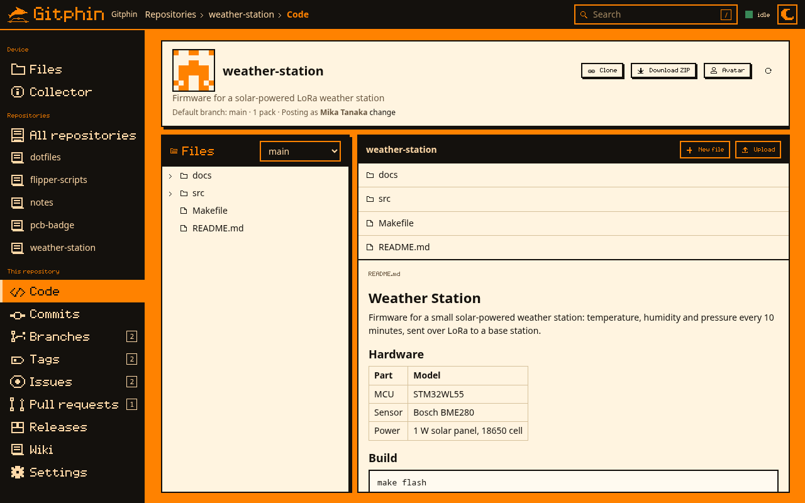
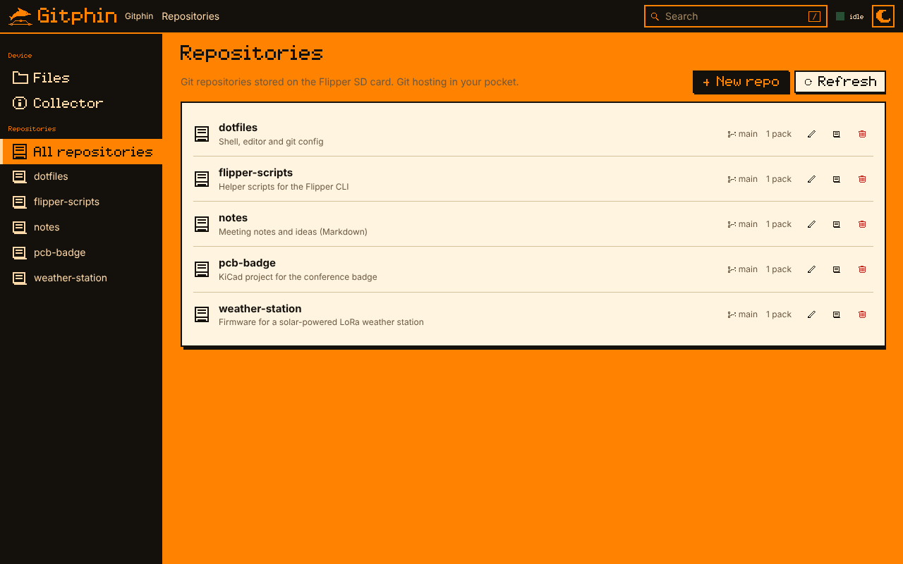
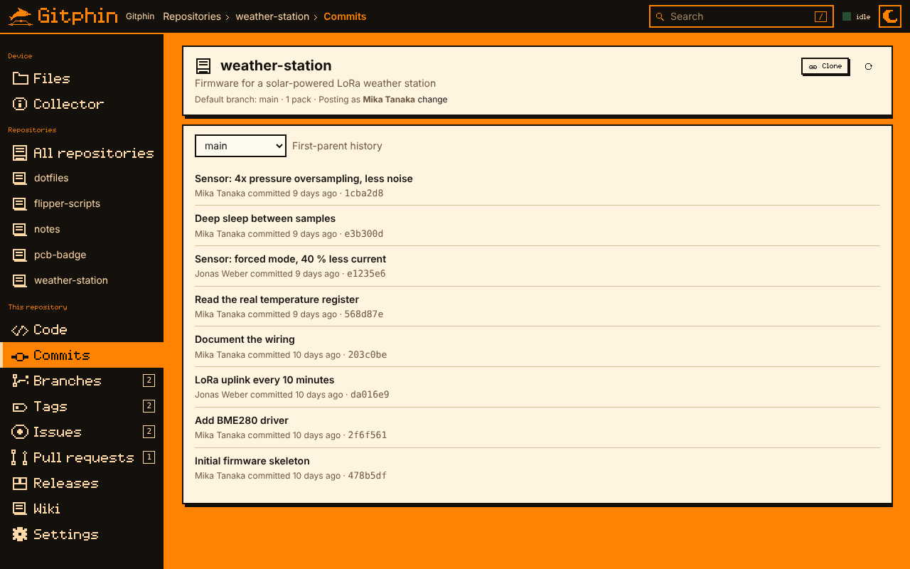
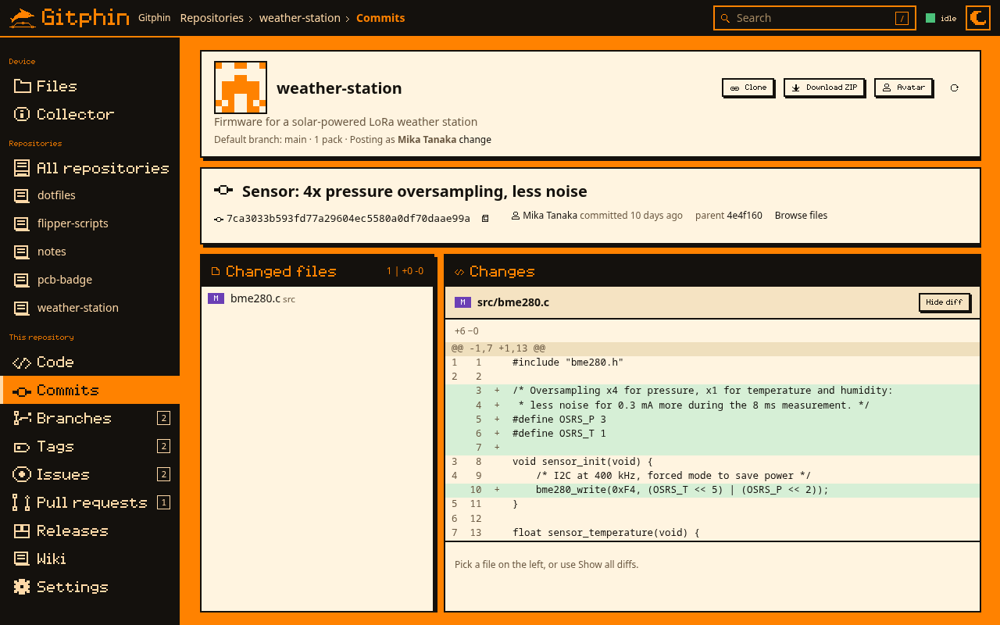
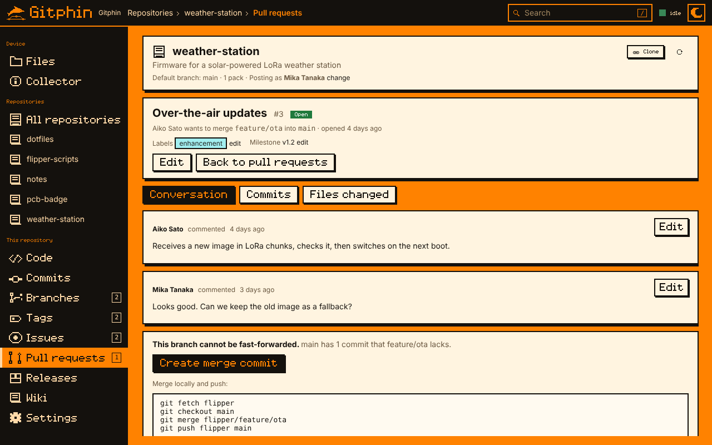
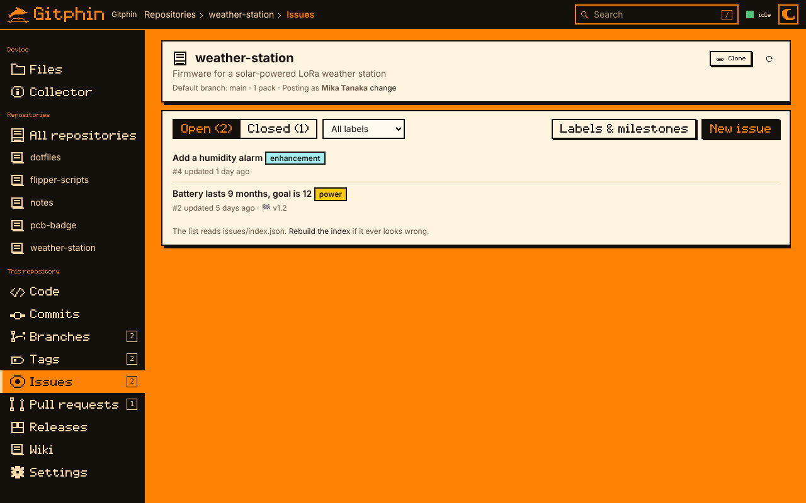
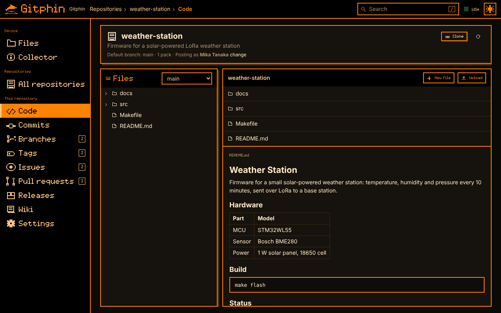
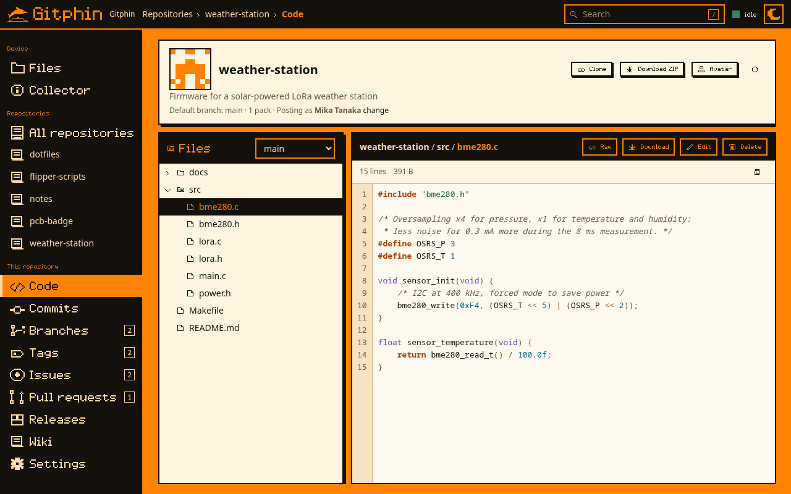
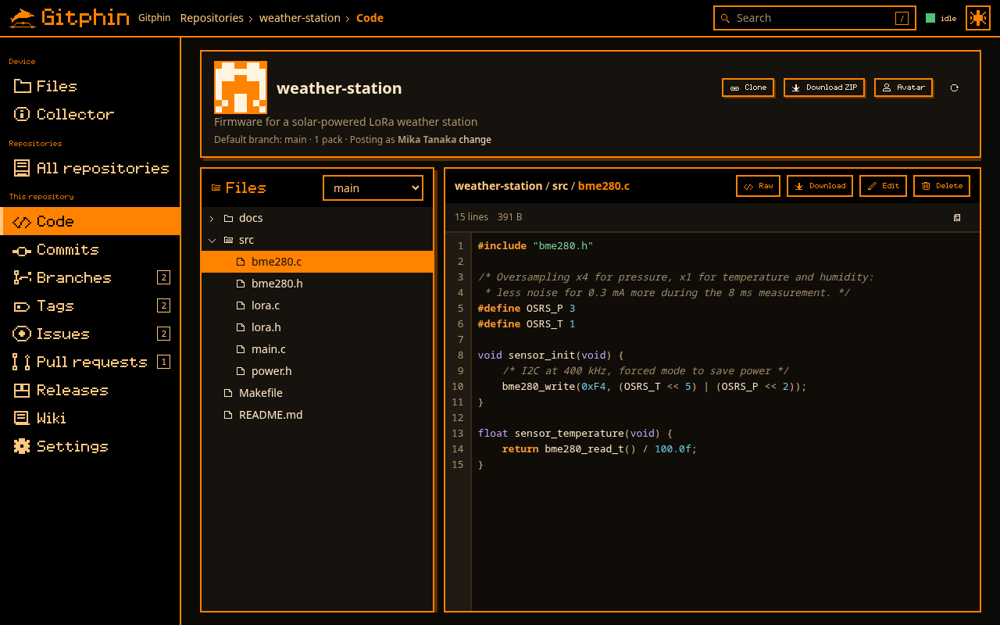
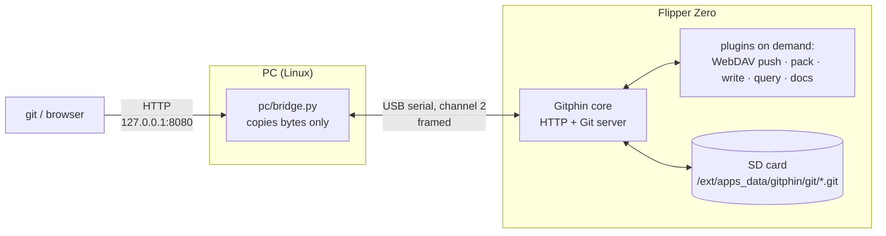

<div align="center">


# Gitphin

### Git hosting in your pocket — a Git server with a web UI that runs on the Flipper Zero.

Gitphin keeps your Git repositories on the Flipper's SD card and serves them to plain `git`
over USB. Plug the Flipper in, `git push`, and browse code, commits, diffs, branches, tags,
issues, pull requests, releases and a wiki at <http://localhost:8080> — no server, no cloud,
no account.

[](https://github.com/Adhamura/Gitphin/actions/workflows/ci.yml)
[](https://github.com/Adhamura/Gitphin/releases)
[](LICENSE)


[**Download**](https://github.com/Adhamura/Gitphin/releases/latest) ·
[Screenshots](#screenshots) · [Why Gitphin](#why-gitphin) · [Install](#install) · [FAQ](#faq)



</div>

> [!NOTE]
> **Not affiliated with Flipper Devices.** Gitphin is an independent open-source project.
> Flipper Zero is a trademark of Flipper Devices Inc. and is used only to name the hardware
> Gitphin runs on. Git is a trademark of the Software Freedom Conservancy.

## Why Gitphin

Your code usually lives on a laptop and on a server somewhere. Gitphin adds a third place you
always carry: the Flipper Zero. It is a real Git remote with a Gitea-like web UI, running on
the device itself, reached from the PC over the USB cable.

- **🐬 A Git server on the Flipper.** The app speaks Git's HTTP protocol itself: `git clone`,
  `pull` and `push` work with the `git` you already have. No helper, plugin or special remote
  is needed.
- **🌐 A full web UI.** Code browser with Markdown READMEs, commit history, diffs, compare,
  branches, tags, search, file edits and uploads, **issues**, **pull requests** with merge,
  **releases** and a **wiki** — rendered in your browser, served by the Flipper. Syntax
  highlighting, repo avatars and **Download ZIP** of any branch or tag.
- **🔌 Offline and private.** Nothing leaves the cable: the PC bridge listens on `127.0.0.1`
  only. No account, no cloud, no telemetry.
- **🗂️ Your repos stay normal Git.** Each repo is an ordinary bare repository on the SD card
  (`/ext/apps_data/gitphin/git/<name>.git`). Copy it to any PC and use it there; issues and wiki live next to it
  as plain JSON and Markdown.
- **🛡️ Built for 256 KB of RAM.** A 47 KB core plus five plugins loaded on demand, a guarded
  allocator that answers "low memory, try again" instead of crashing, streamed answers,
  temp-file + rename for every write, and a bridge that reboots a stuck Flipper. A power loss
  never corrupts a repo.
- **🧹 Housekeeping while idle.** When the Flipper is idle, Gitphin packs loose objects, merges
  small packs and builds a commit graph, in short slices, so clones and history stay fast.
- **🪶 Small and open.** Plain C on the Flipper (no external libraries, its own inflate,
  deflate and SHA-1), standard-library Python on the PC, MIT licensed.

## Screenshots

<table>
  <tr>
    <td width="50%"><br><b>Repositories</b> — every repo on the SD card with its avatar; create, rename, describe, delete</td>
    <td width="50%"><br><b>Commits</b> — history per branch, authors, short SHAs</td>
  </tr>
  <tr>
    <td><br><b>Diffs</b> — changed files and line diffs, computed on the Flipper</td>
    <td><br><b>Pull requests</b> — conversation, commits, files changed, merge on the device</td>
  </tr>
  <tr>
    <td><br><b>Issues</b> — labels, milestones, comments, open / closed</td>
    <td><br><b>Dark theme</b> — follows the system, or switch it in the header</td>
  </tr>
  <tr>
    <td><br><b>Syntax highlighting</b> — C, Python, JS, Go, Rust, shell, Markdown and more, no libraries; Download ZIP and Avatar in the header</td>
    <td><br><b>Highlighting, dark theme</b> — colors tuned for both themes</td>
  </tr>
</table>

<sub>Screenshots show made-up demo repositories, rendered by the app's real route code on the PC
with <code>tools/screenshots/capture.sh</code>.</sub>

## How it compares

We know of no other Git server that runs on the Flipper Zero itself. These are the usual ways to
keep a portable or private Git remote:

| | **Gitphin** | Bare repo on a USB stick | Flipper *Mass Storage* app + bare repo | Gitea / Forgejo on a Raspberry Pi | GitHub / GitLab |
|---|:--|:--|:--|:--|:--|
| Lives on a device you already carry | ✅ | ➖ extra stick | ✅ | ❌ | — |
| Works offline, nothing on the network | ✅ | ✅ | ✅ | ➖ LAN | ❌ |
| Plain `git clone` / `pull` / `push` | ✅ HTTP | ✅ file path | ✅ file path (slow) | ✅ | ✅ |
| Web UI: code, commits, diffs | ✅ | ❌ | ❌ | ✅ | ✅ |
| Issues, pull requests, releases, wiki | ✅ | ❌ | ❌ | ✅ | ✅ |
| Repos are normal bare repos you can copy | ✅ | ✅ | ✅ | ➖ on the server disk | ❌ export |
| Safe when unplugged during a write | ✅ temp + rename | ➖ file system | ➖ disk image | ✅ | ✅ |
| No setup on the network, no account | ✅ | ✅ | ✅ | ❌ | ❌ |
| Users, permissions, SSH, CI, webhooks | ❌ | ❌ | ❌ | ✅ | ✅ |
| Big repos (hundreds of MB) | ❌ a few MB | ✅ | ➖ | ✅ | ✅ |

<sub>✅ yes · ➖ partial, or depends on setup · ❌ no. Based on each tool's public documentation;
corrections are welcome in an issue. Gitea, Forgejo and the cloud services are far bigger
products — Gitphin is for people who want their own Git remote, with a real UI, in their
pocket.</sub>

## Requirements

- **Flipper Zero** with a microSD card, on **official firmware**. Release downloads are built
  for the current official **release** and **dev** firmware; the app must match the firmware's
  API version (see [FAQ](#faq) for custom firmware).
- **Linux PC** for the bridge: Python 3, `git`, and a systemd user session for the automatic
  start (the bridge also runs by hand). macOS and Windows: not supported yet.
- `git` and a browser on the PC.

## Install

Two parts: the **app** on the Flipper and the small **bridge** on the PC.

### 1. The Flipper app

Download **`gitphin.fap`** from [**Releases**](https://github.com/Adhamura/Gitphin/releases/latest)
and copy it to the SD card as **`/ext/apps/Tools/gitphin.fap`** with
[qFlipper](https://flipperzero.one/update) or the [Flipper Lab](https://lab.flipper.net) file
manager. The web page and the plugins are inside the `.fap`; the Flipper unpacks them on the
first start. On dev firmware use the file from `gitphin-<version>-dev-firmware.zip`.

### 2. The PC bridge

Download `gitphin-<version>-pc.tar.gz` from the same release (or clone this repository), then:

```bash
tar xzf gitphin-*-pc.tar.gz && cd gitphin-*-pc
./install.sh            # Python venv + systemd user units, no sudo
./install.sh --remove   # undo
```

The bridge needs read/write access to the Flipper's serial port. Install the udev rule once
(`install.sh` prints the command). It gives the desktop user access at once, with no group
change and no new login:

```bash
sudo install -m 644 systemd/70-gitphin.rules /etc/udev/rules.d/70-gitphin.rules
sudo udevadm control --reload && sudo udevadm trigger --subsystem-match=tty
```

Membership in the `uucp` group also works, after a new login. Check downloads with
`sha256sum -c SHA256SUMS --ignore-missing`.

### From source

```bash
pip install ufbt && ufbt update           # SDK for your firmware (ufbt update --channel=dev for dev)
pc/tools/build_page.sh                    # gzip the web page
systemctl --user stop gitphin.path gitphin.service   # one program may start the app at a time
cd flipper_app && ufbt launch; cd ..
systemctl --user start gitphin.path gitphin.service
```

`ufbt launch` reports a "device disconnected" error after the upload. That is expected: the app
switches USB to two ports, so the port drops for a moment.

**Releases are automatic.** Bump `fap_version` in `flipper_app/application.fam`, add a
`## <version>` section to `CHANGELOG.md` and a `v<version>:` entry to
`flipper_app/docs/changelog.md`, and merge to `main`: GitHub Actions builds the app for the
release and dev firmware, packs the PC bridge and publishes the release `v<version>` with the
changelog section as notes.

## Using Gitphin

Plug the Flipper in. The bridge starts Gitphin by itself and shows a notification with the
link (`--open-browser` in the service opens it). Then:

```bash
# put an existing repo on the Flipper (the repo is created on the first push)
git remote add flipper http://127.0.0.1:8080/git/myproject.git
git push flipper main --tags

# clone, pull, push as usual
git clone http://127.0.0.1:8080/git/myproject.git
git pull
git push
```

Open <http://localhost:8080> for the web UI. Repos live on the SD card in `/ext/apps_data/gitphin/git/<name>.git`.

**Optional, faster pushes:** `install.sh` also installs `git-remote-flipper`, a helper for
`flipper://<repo>` remotes. It sends one pack instead of many single objects (much faster for
big pushes) and adds `git flipper list | create | delete | rename | describe | url | gc`.
Nothing depends on it.

```bash
git remote add flipper flipper://myproject
git push flipper main
```

### Extras on the PC

The bridge and `git flipper` add a few things that the Flipper alone cannot do. All settings are
in `~/.config/gitphin/` (mode 0600); the running bridge reads them again at each use.

**Push to both.** `git flipper mirror-add [remote]` adds the Flipper as a second push URL of a
remote (default `origin`; use `--name <repo>` if the Flipper repo is not named like the folder).
After that, one `git push` updates GitHub and the Flipper together. Fetching still uses the
original URL. The original push URL stays first. The repo is created on the Flipper if it is
missing. `git flipper mirror-remove [remote]` undoes it.

```bash
git flipper mirror-add            # in your project: origin now pushes to GitHub and the Flipper
git push                          # updates both
```

**Backup on plug-in.** Every time the Flipper connects, the bridge copies all repos to
`~/GitphinBackup/<name>.git` (`git clone --mirror` the first time, `git remote update --prune`
after that) and shows one notification, for example "Backup: 5 repos up to date". It starts a
repo only when no request is running, runs git at low priority and pauses between repos.
Repos you delete on the Flipper stay in the backup.

```bash
git flipper backup               # status: last run and result per repo
git flipper backup now           # run it now
git flipper backup off|on        # switch the automatic run
git flipper backup dir ~/Backups/flipper
```

**Webhooks.** After a push, a web edit, a merge or a repo change, the bridge posts JSON to your
URLs (same events as Gitphin Droid): `push` (refs before/after and the head commit),
`repo_created`, `repo_deleted`. It waits until a repo has been quiet for 2 s, sends from a
background thread (the page never waits), and tries again after 2, 8 and 30 s on errors. Headers:
`X-Gitphin-Event`, `X-Gitphin-Delivery`, and `X-Gitphin-Signature-256: sha256=<hmac>` when you
set a secret (same scheme as GitHub). `GET /pc/webhooks` lists the URLs and the last delivery.

```bash
git flipper webhook add https://example.com/hook
git flipper webhook secret mysecret
git flipper webhook test          # sends a ping to every URL
git flipper webhook list | remove <url>
```

**ZIP download.** `http://127.0.0.1:8080/pc/zip?name=<repo>&ref=<branch|tag|sha>[&path=sub/dir]`
downloads the files of a ref as `<repo>-<ref>.zip`, like `git archive` (top folder
`<repo>-<ref>/`, executable bit and symlinks kept). The bridge builds the zip and reads the
Flipper one file at a time, so the page keeps working while it runs, only slower. A big repo
takes a while: every file is one request over USB.

**The Flipper screen** shows the state (Waiting for PC, Ready, Busy, Packing, STUCK), and during
transfers a progress bar, object count, KB and speed.

## How it works



| Part | Runs on | Does |
|---|---|---|
| Gitphin app (`flipper_app/`) | Flipper Zero | HTTP server, Git dumb-HTTP + WebDAV, object reader, diff, merge, search, docs, web page |
| Bridge (`pc/bridge.py`, code in `pc/gitphin_bridge/`) | PC, systemd user unit | starts the app on plug-in, maps TCP `127.0.0.1:8080` onto USB, reboots a stuck Flipper, ZIP download, webhooks, backup on plug-in |
| `git-remote-flipper` (`pc/`, code in `pc/gitphin_git/`) | PC, optional | `flipper://` remotes, pack pushes, `git flipper` CLI (also webhook, backup, mirror-add) |

<details>
<summary>Protocol, storage, memory and self-protection</summary>

**Path of a request.** Git or the browser talks HTTP to `127.0.0.1:8080`. The bridge copies the
bytes, unchanged, into frames on the Flipper's second USB serial channel. The Gitphin app parses
the HTTP request, does the Git work and answers. One request runs at a time; the bridge queues
the rest.

**Plain git, no helper.**
- *Clone, fetch, pull* use git's "dumb HTTP" protocol: git downloads `info/refs`,
  `objects/info/packs`, pack files and loose objects as plain files.
- *Push* uses git's built-in WebDAV fallback (`git http-push`): git uploads each object as a
  file (PUT + MOVE), then updates the branch under a lock. The first push to an unknown name
  creates the repo.
- The PC's git does the heavy Git work (packing, deltas, hashing). The Flipper stores and serves
  files and reads objects for the web page.

**Repository storage.** Each repo is a normal bare repository at `/ext/apps_data/gitphin/git/<name>.git`. Extra
Gitphin data lives in `<repo>.git/hub/`: issues, pull requests, wiki and releases (JSON /
Markdown documents with ETag conflict checks), the commit graph (`graph.bin`) and caches. Git
ignores this folder.

**Background work (when the Flipper is idle for 10 s).** Loose objects from pushes are packed
into one pack; small packs are merged; a commit graph (about 70 bytes per commit) is built so
compare, merge and log do not unpack every commit. Each step runs in slices of about 3 s and
keeps its progress.

**Memory design.** Apps from the SD card run from RAM, so code competes with work memory (about
187 KB heap in total).
- A small resident core (~47 KB code) plus five plugins (4–15 KB each), loaded only while they
  are needed, one at a time. The plugins ship inside the `.fap` and are unpacked to
  `/ext/apps_assets/gitphin/plugins/`.
- Every allocation goes through a guarded allocator: it refuses a request that does not fit the
  largest free block plus an 8 KB reserve, and the route answers `503 low memory, try again`.
  (The firmware halts the device when a normal malloc fails.)
- Answers are streamed in 512-byte pieces, the zlib window is at most 8 KB in RAM (older bytes
  are read back from the SD card), and big delta objects are rebuilt through temp files.
- Free heap with Gitphin running: about 80–85 KB.

**Self-protection.**
- Every route checks free memory first and has a deadline (60 s for merge, compare and diff;
  20 s for search).
- The screen spinner moves only while the worker is alive; "STUCK" appears when it is not.
- If the app stops answering for 3 minutes, the bridge reboots the Flipper. All writes use a temp
  file + rename, so a reboot does not corrupt repos.

**Web page.** Served gzipped (~47 KB) from the SD card; all rendering, diffs and Markdown run in
the browser. The page sends one request at a time and caches everything addressed by a commit /
object SHA, so the Flipper is asked as little as possible.

**Frame format (bridge ↔ Flipper).** `0xA5 | type | len_lo | len_hi | payload` with types OPEN
0x01, DATA 0x02, CLOSE 0x03, PING 0x10, PONG 0x11; payload up to 1024 bytes. The bridge sends
OPEN, the whole request as DATA, then reads DATA until CLOSE.

The full design — routes, formats, resource limits — is in [docs/git-design.md](docs/git-design.md);
the file API and the Collector routes are in [docs/api.md](docs/api.md).
</details>

## Limitations

- **Local only.** The bridge listens on `127.0.0.1`; other machines cannot reach it. There are no
  users, logins or permissions.
- **Speed.** Downloads run at about 330 KB/s, uploads at about 120 KB/s. Plain `git push` costs
  about 0.3 s per object (SD-card writes), so a first push of a big repo takes minutes; the
  optional `flipper://` helper pushes one pack instead and is much faster.
- **Repo size.** Comfortable up to a few MB and a few thousand commits. Larger repos work but get
  slow (compare / merge history walks are capped at 500 commits; files over 64 KB are skipped by
  search).
- **Merge on the device** is a tree merge: it works when the two branches changed different
  files. Changes to the same file are a conflict; merge those on the PC and push.
- **Web edits** are limited to files up to 64 KB; issues / wiki documents up to 64 KB each.
- **No hooks, CI, webhooks, SSH, LFS, blame or activity graphs.**
- **One person at a time.** Two simultaneous pushes to the same branch are protected by
  compare-and-swap on the ref, but the WebDAV locks are simple.
- **Push progress.** Git never tells the server how many objects a push will send, so the screen
  shows the current file and a running count, not a total %. Clones of packed repos show the
  total %.
- **Linux PC only** for the bridge (systemd, udev); the Flipper side is independent.

## Tips

- **Turn the SD desktop animations off** (they take about 49 KB of RAM): rename
  `/ext/dolphin/manifest.txt` to `manifest.txt.off`. With them on, heavy pages answer
  "low memory" more often.
- **Close qFlipper and Flipper Lab** while you use Gitphin: they hold the USB port and use RAM.
- **Never close a busy Gitphin with Back or `loader close`**: the loader can freeze. Reboot instead
  (Left + Back for 5 s). Data stays safe.
- **After a firmware update**, install the matching `gitphin.fap` (or rebuild with `ufbt update`),
  or the app will not start.
- **Back up your repos.** The bridge mirrors them to `~/GitphinBackup` on every plug-in (see
  [Extras on the PC](#extras-on-the-pc)). They are also normal bare repos: you can copy
  `/ext/apps_data/gitphin/git/` from the SD card.
- **Give big pushes time.** Leave the Flipper connected and idle afterwards so it can pack and
  build the commit graph.
- **If something hangs:** `journalctl --user -u gitphin.service -f` shows what happened, and the
  bridge reboots the Flipper itself after 3 minutes.

## FAQ

**What is it for?** Gitphin is an extra Git remote that you carry in your pocket, with a web UI
(code, commits, diffs, issues, pull requests, wiki) and no network, account or server to run.
Use it as a private remote for projects you do not want on a cloud service, as a second copy of
your work next to GitHub, as a way to move code between PCs without a network, or just because it
is fun to push to a Flipper.

**Is it a single point of failure?** No, if you use it as intended: it is an *extra* remote, not
the only copy. Every `git clone` is a full copy of the history. The bridge also mirrors all repos
to `~/GitphinBackup` each time you plug the Flipper in, and `git flipper mirror-add` makes one
`git push` update GitHub (or any other remote) and the Flipper together. SD cards can fail or get
lost like any storage, so keep at least one other copy of work you care about.

**Do I need anything on the PC besides git?** The bridge: a small Python program
(`pc/bridge.py`) and `pyserial` (`install.sh` sets it up). It copies bytes between
`127.0.0.1:8080` and the USB port; all Git and HTTP logic runs on the Flipper. The
[extras](#extras-on-the-pc) (ZIP, webhooks, backup) run in the bridge.

**Is my code safe if I pull the cable mid-push?** Yes. Every write goes to a temp file and is
renamed into place, refs are updated with compare-and-swap, and an interrupted push leaves the old
branch tip in place. Repos are plain bare repositories that `git fsck` can check on any PC.

**Does it work on custom firmware (Momentum, Unleashed, RogueMaster)?** Not tested. Apps must be
built for the firmware's API version: build from source with that firmware's SDK
(`ufbt update --index-url=…` or `--url=…`), then `ufbt launch`. Reports are welcome.

**Does it work on macOS or Windows?** The Flipper app does; the bridge is Linux-only for now
(serial device names, systemd, udev). A port is on the [roadmap](#roadmap).

**Can several people use it?** Over USB, one PC at a time. There are no accounts; issues and
comments carry a name you set once in the browser.

**Why HTTP and not SSH?** HTTP needs no keys and works with plain `git`; the Flipper has no
network stack of its own, and the USB bridge keeps everything on `127.0.0.1`.

**What is the Collector tab?** An optional extra: the bridge (not the Flipper) answers
`/pc/info` with facts about the PC (hostname, OS, CPU, memory, uptime, addresses) and `/pc/wifi`
with the connected Wi-Fi's name. Showing the saved Wi-Fi password is **off** unless you install
a narrow root helper yourself; see [docs/api.md](docs/api.md).

**How do I report a bug?** [Open an issue](https://github.com/Adhamura/Gitphin/issues/new/choose)
with your firmware version, the Gitphin version and the bridge log
(`journalctl --user -u gitphin.service -b`). Security problems: see [SECURITY.md](SECURITY.md).

## Roadmap

- **1.0** — ✅ Git server and web UI on the Flipper: clone / pull / push, code, commits, diffs,
  compare, branches, tags, search, web edits, issues, pull requests with tree merge, releases,
  wiki; idle packing and commit graph; Linux bridge; single-file `.fap` with embedded plugins.
- **Next** — listing in the Flipper Apps Catalog.
- **Ideas, not scheduled** — macOS and Windows bridge; blame; a Wi-Fi Dev Board transport
  (no PC bridge).

Ideas and features you miss: [open an issue](https://github.com/Adhamura/Gitphin/issues/new/choose).

## Contributing

Bug reports with your firmware version and bridge log help most. For code: the host tests in
`pc/tests/` run the real app code on the PC against `git` (`pc/tests/run_*.sh`, gcc + zlib +
ASan); CI runs them and builds the app with uFBT for the release and dev firmware. New features
belong in a plugin, not the core (code size is at its limit), and must follow the "Resource
limits" rules in [docs/git-design.md](docs/git-design.md). `tools/screenshots/capture.sh` makes
the README screenshots without a Flipper.

## License

MIT. See [LICENSE](LICENSE).
