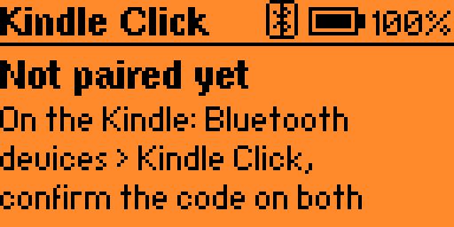

# Kindle Click for Flipper Zero

A Flipper Zero app that a Kindle accepts as a Kindle Click remote: page forward and back, light up and down, and sleep. The Kindle also shows the Flipper's battery level.

  
  

Keys
----

| Flipper | Kindle |
|---|---|
| Right | page forward |
| Left | page back |
| Up / Down | light up / down (repeats while held) |
| OK, held 1 s | sleep |
| Back | menu (Remote, Buttons, Forget Kindle); Back again exits |

Buttons in the menu lets you assign any of the keys (including a short press of OK) to page forward, page back, light up, light down, sleep, or off.

Keep the app open while you read. While it runs, the Flipper's own Bluetooth (for the phone app) is off.

Install
-------

Use one of these ways:

* Use Flipper Apps Catalog: https://lab.flipper.net/apps/kindle_click

* Download `kindle_click.fap` from [Releases](https://github.com/zuyan9/Flipper-Zero-Kindle-Click/releases) and copy it to `apps/Bluetooth` on the Flipper's SD card, with qFlipper or the Flipper mobile app. The release is built for official firmware 1.5.1.

* To build it yourself, install [ufbt](https://github.com/flipperdevices/flipperzero-ufbt) (`pipx install ufbt`), connect the Flipper over USB and run `ufbt launch` in this folder. ufbt builds against the latest official firmware release by default.

The app is then in Apps › Bluetooth.

Pairing
-------

Open the app, then on the Kindle open Settings › Wi-Fi & Bluetooth › Bluetooth devices and choose the Kindle Click. The Kindle and the Flipper show the same code: confirm it on both.

To pair again, forget it on the Kindle (Bluetooth devices › the remote › Forget) and choose it again. Forget Kindle in the app's menu removes the pairing from the Flipper; forget the remote on the Kindle too.

Known limits
------------

- The remote can't wake the Kindle; no remote can. After you wake it, the app reconnects within a few seconds, and a page turn pressed meanwhile is delivered once the Kindle is ready (about 5 s after the press in testing).
- Kindle firmware 5.20.1 doesn't count remote page turns as activity, so the Kindle still sleeps when its sleep timer runs out after the last screen touch.
- Only Kindle models with Kindle Click support accept it.

How it works
------------

The Kindle lists a remote only if its advertisement itself carries Amazon's company ID and the Kindle Click's product ID. The Flipper firmware puts manufacturer data only in the scan response, so the app passes it as the advertised name, whose first byte the firmware sends as the data type. The Kindle names the remote itself. [PROTOCOL.md](https://github.com/zuyan9/Open-Kindle-Click-nRF52840/blob/main/PROTOCOL.md) describes what the Kindle checks.

The firmware also slows advertising from every 80–100 ms to every 1–2.5 s after a minute, so while the app waits for the Kindle it restarts advertising every 55 s.

Reference
---------

- [Open-Kindle-Click-nRF52840](https://github.com/zuyan9/Open-Kindle-Click-nRF52840): the same remote as XIAO nRF52840 firmware
- [Open-Kindle-Click-Android](https://github.com/zuyan9/Open-Kindle-Click-Android): an Android phone as the remote

Not affiliated with Amazon. Kindle is a trademark of Amazon.com, Inc. or its affiliates.
