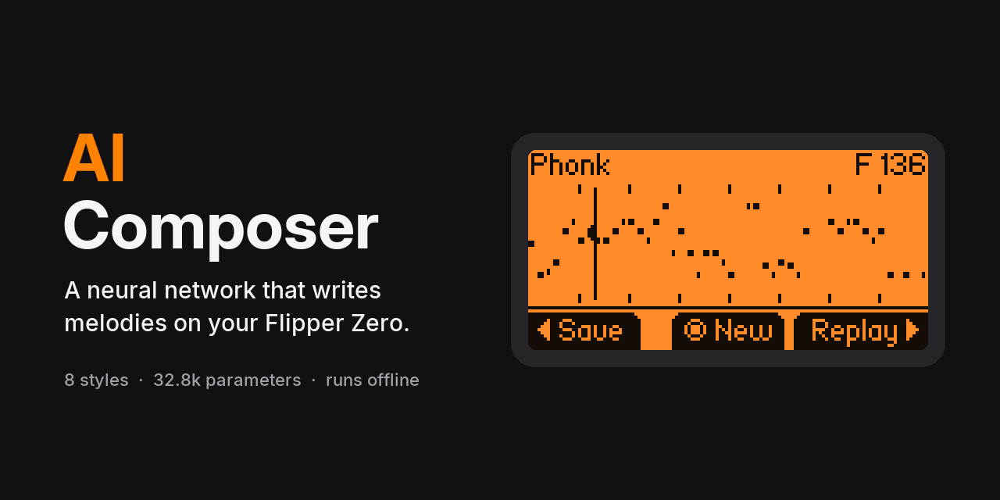
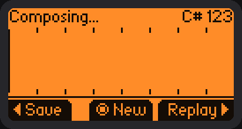
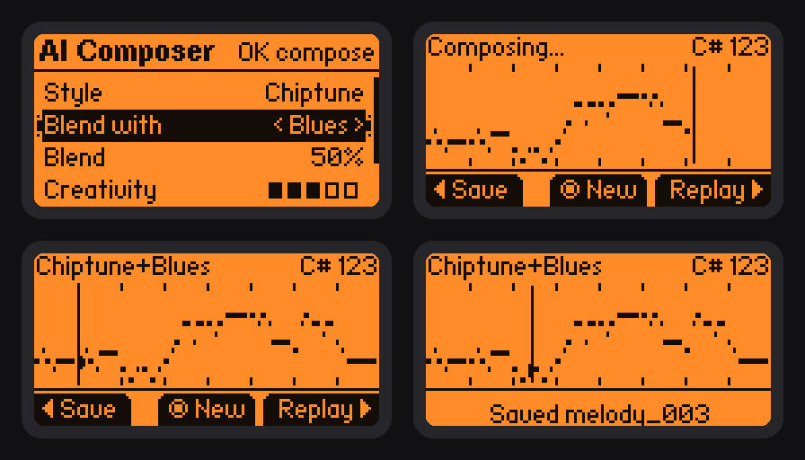
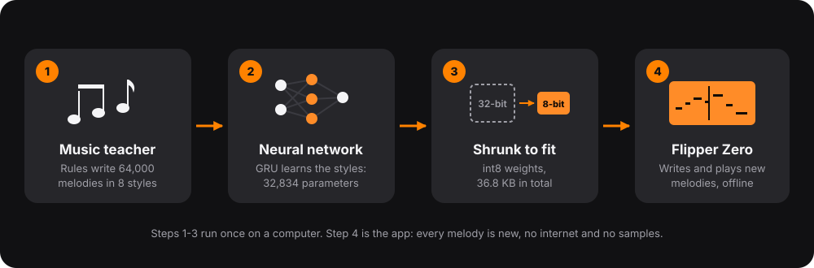

<p align="center">
  
</p>

<p align="center">
  <b>A tiny neural network that writes brand-new melodies – on the Flipper Zero itself.</b><br>
  No internet, no computer, no samples: every tune is invented note by note on the device.
</p>

<p align="center">
  <a href="https://github.com/TheProductAgency/flipper-ai-composer/actions/workflows/build.yml"></a>
  
  
  
  <a href="#deutsch"></a>
</p>

<p align="center">
  
</p>

## Features

- **Eight styles** – Chiptune, Blues, Classical, Folk, Game, Phonk, Hip-Hop and Jazz.
- **Blend two styles**, e.g. 70 % Classical + 30 % Jazz. The network mixes them inside its own
  learned “style space”, something a fixed rule set cannot do.
- **Creativity** in five steps, from careful and predictable to wild and surprising.
- **Any key**, fixed or random, and adjustable **volume**.
- **Watch it write:** the 8 bars fill the 128-pixel screen exactly (1 pixel per sixteenth note); then
  the melody plays on the speaker with a moving playhead and the LED blinking on every bar.
- **Save** melodies you like as `.fmf` files for the built-in Music Player.
- Runs **entirely on the Flipper** with its own speaker, LED and display – no extra hardware.

<p align="center">
  
</p>

The speaker plays one note at a time, so every style is a melody line: Phonk is its cowbell riff and
Hip-Hop its laid-back loop, without beat or bass.

## How it works

<p align="center">
  
</p>

1. **A music teacher writes the lessons.** [`training/teacher.py`](training/teacher.py) is a
   rule-based composer: scales, chord progressions, rhythm patterns, repeating motifs and a cadence
   on the tonic, separately for each style. It wrote **64,000 melodies** (8 bars, 4/4) for training.
   No third-party songs are involved, so there are no copyright questions.
2. **A small neural network learns from them.** [`training/model.py`](training/model.py) is a GRU
   with 80 hidden units. It reads the previous note, the position in the bar and a style vector, and
   predicts the next pitch and then its length – **32,834 parameters** in total. Training takes about
   five minutes on a laptop. Its melodies match the teacher's styles closely in note count, rests,
   rhythm and interval size.
3. **It is shrunk for the Flipper.** [`training/export.py`](training/export.py) rounds every weight to
   8 bits with one scale per row: **36.8 KB**.
4. **The Flipper runs it.** [`composer_model.c`](composer_model.c) is a small, dependency-free C
   implementation. A test compares it with the Python reference on 275 melodies in all styles and
   mixes (11,843 notes): they are identical, apart from a single note where the random number fell
   exactly on the boundary between two pitches.

Creativity is the sampling temperature (0.45 – 1.3); styles are blended by mixing their learned
style vectors; the last note always resolves to the tonic.

## Install

- From **Flipper Lab** or the Flipper mobile app, category *Media* (once the catalog has accepted it),
- or copy `ai_composer.fap` from the [latest release](https://github.com/TheProductAgency/flipper-ai-composer/releases)
  to `SD card/apps/Media/`.

Built for the official firmware (release channel).

## Controls

| Screen | Button | Action |
|---|---|---|
| Studio | ▲ ▼ | Select a setting |
| | ◀ ▶ | Change it |
| | OK | Compose |
| Player | OK | Compose a new melody |
| | ◀ | Save as `.fmf` |
| | ▶ | Replay |
| | Back | Back to the studio |

Saved melodies go to `SD card/apps_data/ai_composer/melody_001.fmf`, `melody_002.fmf`, … Open them in
**Apps → Media → Music Player** by browsing to that folder.

## Building

```sh
python3 -m pip install --upgrade ufbt
ufbt update --channel=release
ufbt                # dist/ai_composer.fap
ufbt launch         # build, install and start over USB
```

Tests run on any computer:

```sh
cc -std=c11 -Wall -Wextra tests/test_music.c composer_music.c composer_model.c composer_weights.c -lm -o /tmp/t && /tmp/t
python3 tests/parity.py      # C inference vs. Python reference, needs numpy
```

Retrain the model (needs PyTorch):

```sh
cd training
python3 train.py --per-style 8000 --epochs 12
python3 export.py composer.pt ../composer_weights.c ../composer_weights.h
```

| Path | Contents |
|---|---|
| `ai_composer.c` | App: studio, player, playback, saving |
| `composer_model.c/.h` | On-device inference (portable C) |
| `composer_music.c/.h` | Notes, tempo, Flipper Music Format |
| `composer_weights.c/.h` | Generated int8 weights |
| `training/` | Teacher, model, training, export, Python reference, WAV preview |
| `tests/` | FMF test and C/Python parity test |
| `docs/` | Catalog description, changelog, images |

## Deutsch

**AI Composer** lässt ein winziges neuronales Netz direkt auf dem Flipper Zero neue Melodien
erfinden – ohne Internet und ohne Computer. Acht Stile (Chiptune, Blues, Klassik, Folk, Game, Phonk,
Hip-Hop, Jazz), zwei Stile mischbar, Kreativität in fünf Stufen, freie Tonart und Lautstärke.

- **Studio:** mit ▲ ▼ eine Einstellung wählen, mit ◀ ▶ ändern, mit OK komponieren.
- **Player:** OK = neue Melodie, ◀ = als `.fmf` speichern (für den Music Player), ▶ = noch einmal,
  Zurück = Studio.

Das Netz (32.834 Parameter, 36,8 KB) hat aus 64.000 Melodien gelernt, die ein eigener,
regelbasierter „Musiklehrer“ geschrieben hat – es stecken keine fremden Songs darin.

## License

[MIT](LICENSE) © 2026 TheProductAgency
