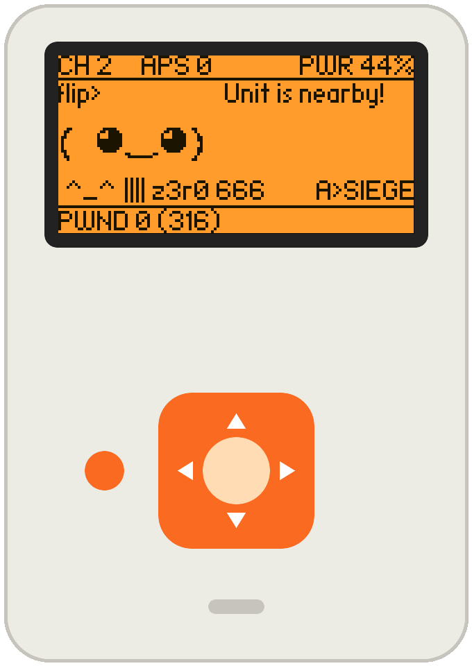
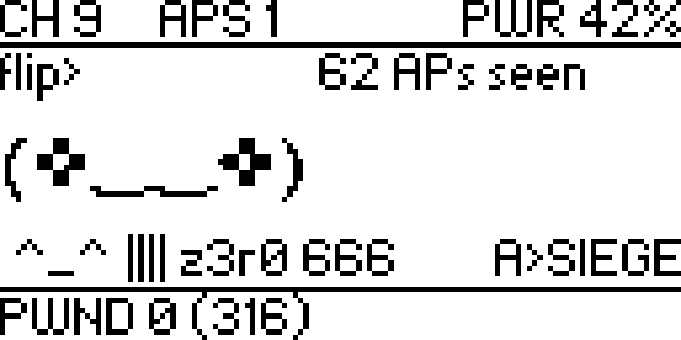
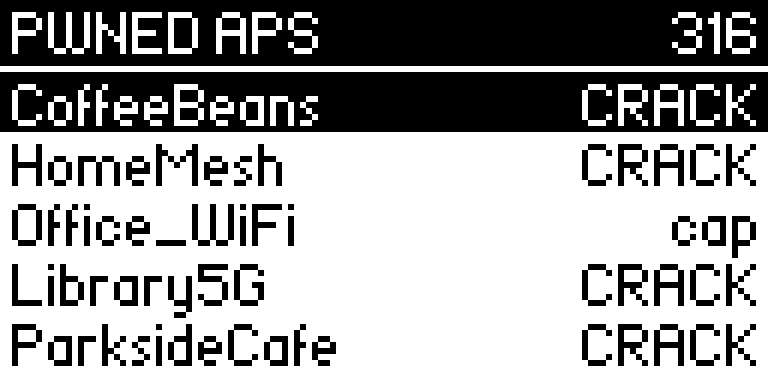
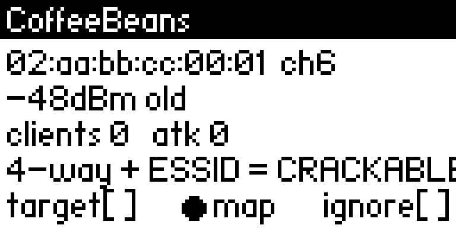

# pwnpal

**A full [pwnagotchi](https://pwnagotchi.org) on your Flipper Zero + ESP32 wifi board.**

pwnpal turns the Flipper's ESP32 board into a self-contained pwnagotchi: it makes friends
with other pwnagotchis over the air, captures WPA/WPA2 handshakes & PMKIDs, wardrives with
GPS, and grows a little persona that levels up the more it sees — all driven from a native
Flipper app, no PC or Raspberry Pi required.

## Screenshots

## What it does

- **Social pwngrid peer** — broadcasts a pwnagotchi-compatible beacon so nearby units
  detect it, say *"Hello!"*, and befriend it over time (stable identity → rising
  encounters → ♥). Sniffs other units back and remembers the friends it meets.
- **Real capture** — WPA/WPA2 4-way **handshakes** and **PMKID**, saved as per-BSSID
  `.pcap` on the Flipper SD, ready for hashcat `-m 22000`.
- **Opt-in attacks** — association (for PMKID) and targeted **deauth** (for handshakes),
  client-aware so effort lands where clients actually are.
- **De-cloak** — recovers hidden ESSIDs from clients' (re)association requests, turning an
  otherwise-uncrackable capture into a crackable one.
- **GPS wardrive** — geotags APs and writes a WiGLE-compatible `wardrive.csv`; on-device
  distance/bearing to a saved home.
- **Capture modes** — *Wardrive* (fast sweep, PMKID-only), *Roam* (sweep + deauth on the
  move), *Siege* (park and hammer one area), *Auto* (switches by movement).
- **On-device browser** — scroll recent APs and pwned APs with live signal bars, client
  counts, target/ignore/de-cloak markers, and a per-AP detail + map QR.
- **Battery saver** — light/deep duty-cycling; auto-off on external power.
- **Web export** — a static, offline page converts your captures to hashcat 22000 and maps
  the wardrive: **https://mrq1911.github.io/pwnpal/**

## Hardware

| Part | Notes |
|---|---|
| Flipper Zero | runs the pwnpal app |
| ESP32 wifi board | **Feberis Pro** (classic ESP32) is the reference board; other Marauder-capable ESP32/S2/S3 boards should work |

The ESP32 runs a **Marauder fork**: pwnpal is a small patch on top of ESP32 Marauder, so a
single flash gives you a **complete Marauder build with an extra `pwnpal` command** — the
normal Marauder GUI and companion apps keep working, pwnpal rides alongside on the same UART.

See [COMPATIBLE_HARDWARE.md](COMPATIBLE_HARDWARE.md) for the board matrix.

## Install

**1. Flash the ESP32 firmware** (once): grab `pwnpal-firmware-<board>.bin` from
[Releases](https://github.com/mrq1911/pwnpal/releases), copy it to the Flipper SD, then in
**Apps → GPIO → ESP Flasher**: *Enter Bootloader* → *Manual Flash* → *Advanced Mode* →
*Custom* slot → the bin @ `0x0` → *FLASH* → *Reset Board*. (Rear switch on the Feberis set
to ESP32.)

**2. Install the app**: copy `pwnpal.fap` to `/ext/apps/GPIO/` (qFlipper or the mobile app),
then launch **Apps → GPIO → Pwnpal**.

## Use

- **OK** opens the menu (Recent APs, Pwned APs, Mode, Advertise, Ignore, Friends, Target,
  Stats, tunables, Set home, Battery saver, Verify captures, Reset, About).
- **Up/Down** on the home screen cycle the capture **Mode** (shown top-right).
- **Left/Right** scroll the persona's stat pages.
- First launch shows a one-time **authorization** screen; accept to arm capture/deauth,
  decline to stay social-only.

Loot lands in `/ext/apps_data/pwnpal/`: `handshakes/*.pcap`, `wardrive.csv`, plus dev
telemetry CSVs. Feed the pcaps + wardrive.csv to the [web export tool](https://mrq1911.github.io/pwnpal/).

## Build from source

- **App (fap):** [`ufbt`](https://github.com/flipperdevices/flipperzero-ufbt) against the
  Unleashed SDK — `cd pwnpal && sh gen_version.sh && ufbt`.
- **Firmware:** clone ESP32 Marauder, run `pwnpal-marauder/apply_pwnpal.py <marauder>` to
  patch in the `pwnpal` command, then build with arduino-cli (see
  [.github/workflows/build-pwnpal.yml](.github/workflows/build-pwnpal.yml)).

Protocol + internals: [doc/PwnpalProtocol.md](doc/PwnpalProtocol.md).
Roadmap: [doc/PwnpalRoadmap.md](doc/PwnpalRoadmap.md).

## Credits & license

MIT. Built on the shoulders of:
[pwnagotchi](https://github.com/evilsocket/pwnagotchi) & pwngrid (evilsocket),
[ESP32 Marauder](https://github.com/justcallmekoko/ESP32Marauder) (justcallmekoko),
the flipagotchi renderer and the original pwnagotchi-flipper (Matt London), and
RogueMaster's pwnagotchi face art. pwnpal by mrq1911.
