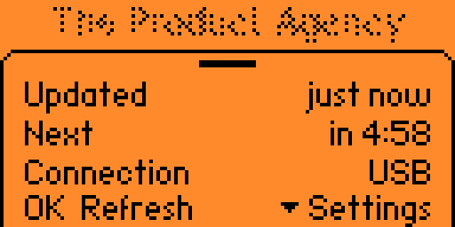

# Jiggler

A mouse jiggler for the [Flipper Zero](https://flipperzero.one) that keeps a computer awake without getting in your way.


 

## What it does

- **Invisible moves.** Every move is a 1 px nudge and an immediate 1 px nudge back. The computer sees a mouse event and resets its idle timer, but the pointer never visibly leaves its spot. Other patterns are available: a random-direction wiggle, a tiny square, or a tap of the F15 or Shift key for programs that only watch the keyboard.
- **Random timing.** You set a shortest and a longest wait, from 5 seconds to 10 minutes, and each move comes at a random moment in between.
- **Pauses while you work.** With the desktop helper running, the Flipper knows how long ago you last touched the real mouse or keyboard and holds off until you have been idle for a while. The helper also reports when the screen is locked, and you can choose whether the jiggler keeps going or pauses then.
- **Run timers.** Stop after a set time, or at a time of day from the Flipper's own clock.
- **Status at a glance.** The screen shows what the jiggler is doing, when the next move is due, how many moves it has made, how long it has been running and what the helper is reporting.
- **Settings are saved** to the SD card.

Without the helper the jiggler still works, it just cannot tell when you are busy. The moves are small enough that this rarely matters.

## Controls

| Button | Action |
| --- | --- |
| OK | Start or stop |
| Right or Up | Settings |
| Back | Quit (also stops the jiggler and gives USB back) |

In settings: Up and Down pick a line, Left and Right change it, Back returns.

## Settings

| Setting | What it does |
| --- | --- |
| Wait at least / at most | The range of random waits between moves |
| Move | Nudge, Wiggle, Square, F15 key or Shift key |
| Resume after idle | How long you must be idle before the jiggler resumes, as reported by the helper. Off ignores the helper. |
| If PC locked | Keep going (the default) or pause while the screen is locked |
| Run for | Stop after 15 minutes to 12 hours |
| Stop at | Stop at a time of day, in quarter hours, from the Flipper's clock |

## The desktop helper

The helper is a small Python script in `helper/`. Once a second it tells the Flipper how long the computer has been idle and whether the screen is locked, and the Flipper answers with its status, shown on one line in the terminal.

```bash
pip install hidapi
python3 helper/jiggler_helper.py
```

It works on macOS, Windows and Linux with X11. On Wayland the idle time is not available to ordinary programs, so the helper runs but the Flipper will not pause for you. The helper needs no special permissions: it talks to the Flipper through a separate USB HID interface, not the mouse or keyboard one. The Flipper's own moves reset the computer's idle timer too, so the helper discounts any input that lines up with a move the Flipper reports.

Press Ctrl+C to stop it. The Flipper notices within a few seconds and carries on without it.

## Notes

- Open the app before plugging the Flipper into the computer, or after, either way. While the app is open the Flipper's USB serial port is replaced by the mouse, so qFlipper and the mobile app cannot talk to it. Quit the app to get the serial port back. If qFlipper is already connected the app says so and asks you to close it first.
- macOS may show its Keyboard Setup Assistant the first time, as it does for any new keyboard. It can be closed.
- The Flipper's own screen and auto-lock behave as usual. The jiggler keeps running with the backlight off.

## Building

Built with [ufbt](https://github.com/flipperdevices/flipperzero-ufbt). Run `ufbt` in the app folder, or `ufbt launch` to build and start it on a connected Flipper.
