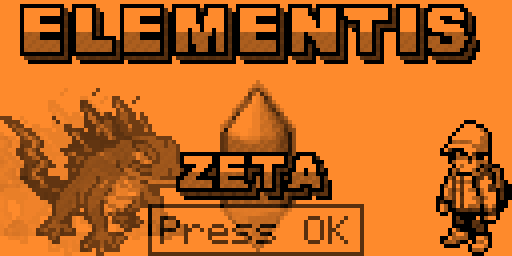
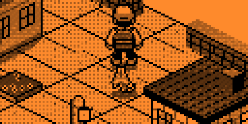
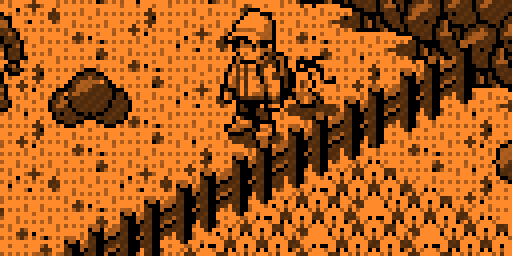
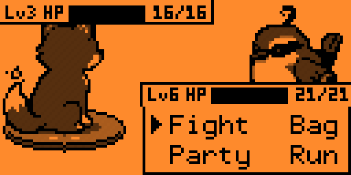
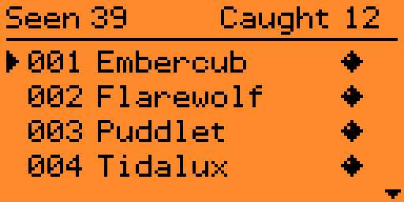
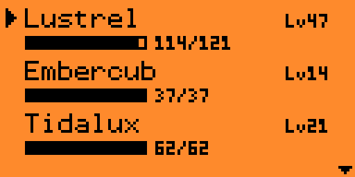

# Elementis Zeta

A creature-collecting RPG for the **Flipper Zero**. Explore towns, routes, caves and gyms, catch and train original creatures, win eight medals and take on the League. The 1-bit screen shows **four gray levels** through a fast temporal flicker.

Creatures, map, characters and music are all original and were made for this game.

## Support / Apoya el proyecto

If you enjoy the game, you can support its development on Ko-fi. It is optional: the game is complete without donating.
Si te gusta el juego, puedes apoyar su desarrollo en Ko-fi. Es voluntario: el juego es completo sin donar.

[](https://ko-fi.com/danielmartinez55371)
**[Support on Ko-fi / Apoya en Ko-fi: ko-fi.com/danielmartinez55371](https://ko-fi.com/danielmartinez55371)**

| | | |
|---|---|---|
|  |  |  |
|  |  |  |

(Screenshots are real frames from a Flipper Zero, shown as the screen looks to the eye.)

## Features

- Nine chapters, from the first village to the League and the post-game; eight medals; Hall of Legacy and credits.
- 150+ original creatures ("Elementis"), turn-based battles with trainers and wild creatures, items, status effects, evolutions, a PC box, a Registro of seen and caught creatures, a trainer card, a casino and save / continue.
- Four languages: Spanish, English, Japanese and Simplified Chinese. Pick one on the first launch (the list starts on English); change it any time in Options.
- 70+ music tracks and sound effects on the speaker, with an Off switch.
- Experimental: trade creatures (including trade evolutions) and fight exhibition battles between two Flippers over the infrared port, face to face.
- Seven loadable plugins (`ez_*.fal`) keep the RAM use low enough for the Flipper; the whole game is one `.fap`.

## Controls

| Key | Action |
|---|---|
| D-pad | Move, navigate menus |
| OK | Talk, interact, confirm |
| Back (short) | Pause menu, cancel |
| Back (hold) | Quit the game |

## Requirements

- Flipper Zero, official firmware **1.5.1** (API 88). Momentum and Unleashed work with their own build (see "API rule").
- A healthy microSD card (A1, 16 to 32 GB). An old or failing card makes the game freeze.
- The game uses most of the Flipper's RAM: close other apps first.
- The first launch unpacks about 5 MB of assets to `/ext/apps_assets/elementis_zeta`. This takes **over a minute**: do not power off or restart the Flipper meanwhile. Saves go to `/ext/apps_data/elementis_zeta`; the game saves only when you choose Save.

## Install

- From the **Flipper Apps Catalog** (Flipper Lab or the mobile app), once it is listed; or
- copy a release `elementis_zeta.fap` to `apps/Games/` on the SD card; or
- build it yourself (below).

## Build

You need [ufbt](https://pypi.org/project/ufbt/) and the SDK of the firmware your Flipper runs. The generated game data is committed (`nucleo/files/`, `nucleo/gen/`), so building the app needs no Python.

```
python3 -m venv .venv && .venv/bin/pip install -r requirements.txt   # once: ufbt and Pillow
.venv/bin/ufbt update --channel=release                               # once: SDK of the official release firmware
cd nucleo
../.venv/bin/ufbt                  # builds elementis_zeta.fap and the seven ez_*.fal plugins into ~/.ufbt/build/
../.venv/bin/ufbt launch           # installs and starts it on a Flipper connected by USB (close qFlipper first)
```

`NUCLEO_DEBUG=1 ufbt` builds the development version (debug overlay and key combos); a normal `ufbt` is the release build players run. To use a separate SDK folder, set `UFBT_HOME=/some/dir` before the commands.

**API rule.** A `.fap` loads only on a firmware with the same API major and an equal-or-newer API minor, so always build with the SDK that matches the device's firmware (`ufbt update --channel=release`, or `--index-url=...` for Momentum / Unleashed).

### Rebuild the game data (optional)

The art, maps, texts, music and data tables are the sources in `assets/` and `maps/`; `tools/build_assets.sh` turns them into `nucleo/files/` and `nucleo/gen/` and runs the checks of every converter. It needs Python 3.11 or newer, Pillow and a C compiler (`cc`):

```
NO_UFBT=1 bash tools/build_assets.sh        # the content pipeline and its checks
```

Without `NO_UFBT=1` the script finishes with `tools/mem_budget.sh` (builds both variants with `ufbt` and checks the RAM budgets; it needs the SDK as above). Many comments in the source mention "contract N": those are section numbers of the author's private engineering notes, which are not published.

## Credits

Design, programming and art: **Daniel Jahziel**. The art was made with **PixelLab**, an AI pixel-art tool. Music: original. Japanese and Chinese text uses Fusion Pixel Font by TakWolf (SIL Open Font License 1.1) and the fonts it is built from. The full list with licences is in [CREDITS.md](CREDITS.md) and the licence texts in `nucleo/files/licenses/`.

## License

The repository has two different terms, split by path (the full text and the exact folder list are in [LICENSE](LICENSE)):

- **Code** (`nucleo/` C / C++ sources, headers and `application.fam`, and the programs in `tools/`): GNU GPL version 3 ([COPYING-GPL-3.0.txt](COPYING-GPL-3.0.txt)).
- **Art and all game content** (pictures, creature and character designs, names, texts and translations, maps, music and data, i.e. `assets/`, `maps/`, `nucleo/files/` and `nucleo/gen/`): **all rights reserved**, (c) 2026 Daniel Jahziel. This content is **not** covered by the GPL, even though it is in the same repository. You may build the app and play it, and you may redistribute the complete, unmodified `.fap` (for example through the Flipper Apps Catalog); you may not reuse, modify or republish the art and content without written permission.
- **Third-party fonts** keep their own licences (`nucleo/files/licenses/`).
- **Trademarks**: the name "Elementis" (Elementis Zeta, Elementis Zero), "Nucleo", the logo, and the names and look of the characters and creatures as brand identity are trademarks of the author and are **not** licensed. A fork needs its own art, name and logo.

See [LICENSE](LICENSE) for the details.

**Not affiliated.** Elementis Zeta is an original work. It is not affiliated with, sponsored by or endorsed by any other game or company, and it uses no names, characters, creatures or art from them. All third-party trademarks belong to their owners.

## Contributing and support

Bug reports and ideas are welcome as issues; please open an issue before sending a pull request. Support the project on Ko-fi: https://ko-fi.com/danielmartinez55371 (see the top of this page).

Source: https://github.com/jahziel1/Elementis-Zeta
