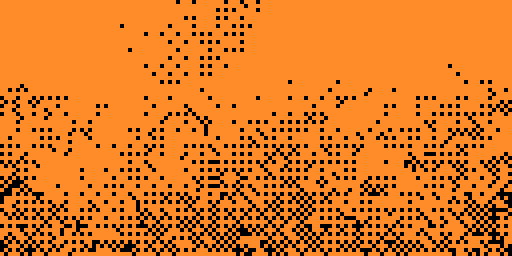
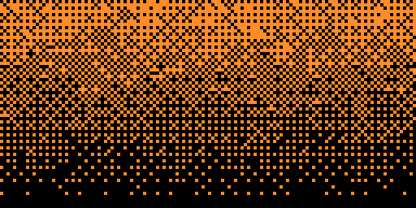
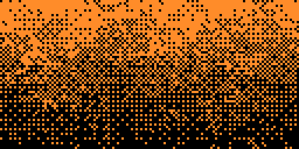

# FlipperFire

The classic PSX Doom fire effect running on the Flipper Zero, with optional crackling fire sound. Based on the [Doom Fire Algorithm Playground](https://github.com/filipedeschamps/doom-fire-algorithm).

The fire is simulated at the full 128x64 screen resolution with 37 intensity levels, which are mapped onto the monochrome display using ordered dithering.

|  |  |
|---|---|
|  |  |

## Controls

- **Up** - ignite the fire at full strength
- **Down** - extinguish the fire
- **Right** - increase the fire intensity
- **Left** - decrease the fire intensity
- **OK** - toggle the crackling sound on or off
- **Back** - exit the app

The sound is off when the app starts. The crackling gets louder and denser the stronger the fire burns.

## Building

Requires [uFBT](https://pypi.org/project/ufbt/). Run `./build.sh` to build `dist/flipper_fire.fap`, or `python3 -m ufbt launch` to build and start the app on a connected Flipper Zero.

## License

MIT