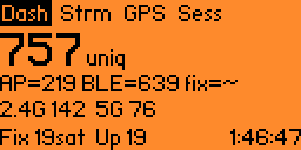
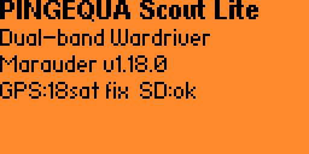

<p align="center">
  
</p>

<h1 align="center">SigRoam — Flipper Zero wardriving app</h1>

<p align="center">
  <b>The survey screen for Scout Lite.</b><br>
  The board runs custom Marauder for Scout Lite. SigRoam shows the survey.
  The Marauder app opens the general menu. Switching apps does not reflash the board.
</p>

<p align="center">
  <a href="https://github.com/pingequalab/sigroam-wardriving/releases/latest"><b>Download the app</b></a>
  · <a href="https://flash.pingequa.com/devices/flipper-sigroam"><b>Choose the file for your Flipper firmware</b></a>
  · <a href="https://flash.pingequa.com/devices/scout-lite"><b>Marauder for Scout Lite</b></a>
  · <a href="https://www.pingequa.com/products/scout-lite?utm_source=github&utm_medium=referral&utm_campaign=pq-scout-lite-c5&utm_content=sigroam-wardriving-readme"><b>Get Scout Lite</b></a>
</p>

<p align="center">
  <a href="https://github.com/pingequalab/sigroam-wardriving/actions/workflows/host-test.yml"></a>
  <a href="https://github.com/pingequalab/sigroam-wardriving/actions/workflows/fap-build.yml"></a>
  <a href="LICENSE"></a>
</p>

The Flipper Zero has no Wi-Fi radio. This app is the survey control. Custom Marauder for Scout Lite does the scan, keeps the log on the board's card, and sends that log to WiGLE when you press Upload.

## Scout Lite

Scout Lite ships with **custom Marauder for Scout Lite** already installed. Both Flipper apps talk to that firmware. Neither app is flashed onto the ESP32.

| On the Flipper | What it does on this board |
|---|---|
| **Marauder app** | 2.4 GHz and 5 GHz scanning, wardrive with GPS, logs on the board card, WiGLE upload, and the general menu for this screenless board |
| **SigRoam** | The survey screen: live counts, GPS, the WiGLE queue, and Board tools |

One radio covers 2.4 GHz and 5 GHz, not both at once. 5 GHz here is scan and enumeration. GPS is on the board. The survey log is on the Scout Lite card, not the Flipper card.

## Screens

| Dashboard | Upload |
|---|---|
|  |  |
| **Probe** | **Board tools** |
|  |  |

**Dashboard.** Live unique count, AP, BLE, 2.4 GHz, 5 GHz, GPS fix, and how many logs are waiting to upload. OK on `Dash` starts the survey. OK again stops it. Back leaves the page and does not stop the survey.

**Upload.** The last result stays on screen, with the count of logs not yet sent. Nothing goes to WiGLE until you press Upload. The file name is shown while that file is sending.

**Probe.** Reads the board and shows PINGEQUA Scout Lite, GPS, and the card. Open it when the board does not answer.

**Board tools.** Ignore list and logs on the card. Split size is on the logs page. The ignore list does not hide a network from the air. It only skips that name in the SD log. On Scout Lite firmware v1.1.0 or later, a split size is saved and kept after reboot. On v1.0.0, a reboot returns it to 1024 KB.

The home menu is Dashboard, Upload, Rank, Board tools, Settings, and About. Probe and Raw log are under Settings. Wi-Fi is opened from Upload.

## Install and start

1. Antenna on. Seat Scout Lite on the Flipper. FAT32 card in Scout Lite, not in the Flipper.
2. The Flipper powers the board on pin 1 and talks on pins 13 and 14. Do not power the board from pin 9 (3.3 V).
3. Download the app from [Releases](https://github.com/pingequalab/sigroam-wardriving/releases/latest). [Choose the file for your Flipper firmware](https://flash.pingequa.com/devices/flipper-sigroam) and copy it to `SD Card/apps/GPIO/` on the Flipper.
4. Set `Settings → System → Log Device` to `Off`, so the system log does not occupy pins 13 and 14. Open `Apps → GPIO → SigRoam Wardriving`.
5. Outdoors, wait for a GPS fix. On Dashboard, press OK on `Dash` to start. Press Upload when you want the logs on WiGLE.

To update the board firmware, use [Marauder for Scout Lite](https://flash.pingequa.com/devices/scout-lite). That is the same custom Marauder already on the board. Switching to the Marauder app does not reflash it.

Wardrive on custom Marauder for Scout Lite transmits while it hops channels. A GPS fix needs open sky. Indoors, a survey may not start.

## WiGLE key and Wi-Fi

The app does not upload over the Flipper radio, and it does not store the CSV on the Flipper card.

**WiGLE key.** Put two plain-text files in the root of the Scout Lite card. Each file holds only its value.

| File | Contents |
|---|---|
| `wigle_api_name.txt` | WiGLE API Name |
| `wigle_api_token.txt` | WiGLE API Token |

Restart the board. It reads both files at boot and deletes them. Check that they are gone. Do not post the files, or a serial log, in an issue.

**Wi-Fi.** The board does not import a network from the card. If Upload says there is no saved Wi-Fi, press WiFi. Saved names are listed when the board answers `sigroam wifi`. Scout Lite firmware v1.1.0 does not have that command, so the list starts empty there; Scan nearby still joins a network and the board saves it for Upload.

You can still copy a CSV off the Scout Lite card and upload it at [WiGLE](https://wigle.net/).

## Build from source

Built with [ufbt](https://github.com/flipperdevices/flipperzero-ufbt):

```bash
ufbt                  # build
ufbt launch           # build, install and run on a connected Flipper
make -C tools/host_test
make -C tools/host_test asan
```

The host tests cover the parser and model. They do not replace on-device testing. Version history is in [CHANGELOG.md](CHANGELOG.md).

## License

GPL-3.0. See [LICENSE](LICENSE).

**PINGEQUA Lab** · [Scout Lite](https://www.pingequa.com/products/scout-lite?utm_source=github&utm_medium=referral&utm_campaign=pq-scout-lite-c5&utm_content=sigroam-wardriving-readme)
· [Marauder for Scout Lite](https://flash.pingequa.com/devices/scout-lite)
· [SigRoam app](https://flash.pingequa.com/devices/flipper-sigroam)
