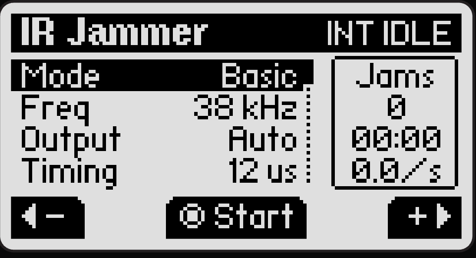

# IR Jammer for Flipper Zero

IR jammer app for the Flipper Zero.
Works with the internal IR LED or an external IR module.

## Features

- 5 modes: Basic, Enhanced Basic, Sweep, Random, Empty
- Output: Auto / Internal / External (external is used when attached)
- Live stats: jams, time, jams per second

## Controls

- **Up / Down**: select setting
- **Left / Right**: change value
- **OK**: start / stop
- **Back**: stop, or exit when idle

## Disclaimer

For use on your own devices and testing only.

## Source

https://github.com/Clawzman/flipper-ir-jammer

## Credits
Ported from the IR jammer in Bruce firmware by Thoxy67
