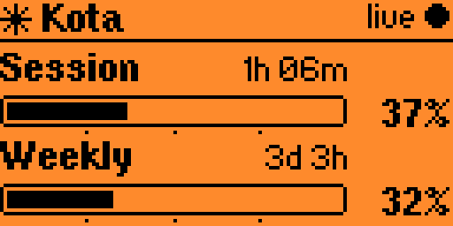

# Kota

Your Claude plan usage on a Flipper Zero, over Bluetooth.



Kota shows the two limits `/usage` shows in Claude Code: the 5-hour session
window and the weekly window, each with a live countdown to its reset. A small
script on your Mac fetches the numbers and pushes them to the Flipper every two
minutes. No cable.

*Kota* is Turkish for "quota".

## How it works

```
Claude Code login ──> host/kota.py (Mac) ──BLE──> Kota app (Flipper)
```

- `host/kota.py` reads the OAuth token Claude Code keeps in
  `~/.claude/.credentials.json` and asks Anthropic for your plan usage.
- It finds the Flipper over Bluetooth LE, waits for the Kota app to say hello,
  and sends one line per update: `U <session%> <session_reset_s> <week%> <week_reset_s>`.
- The Flipper app draws the meters and counts the resets down between updates.

The token never leaves your Mac. Only the numbers go to the Flipper.

## Install

**Flipper:** install Kota from the [Flipper Apps Catalog](https://lab.flipper.net/apps/kota),
or build it yourself:

```bash
cd flipper
ufbt launch      # builds, uploads over USB and opens the app
```

**Mac:** you need [uv](https://docs.astral.sh/uv/) and a logged-in Claude Code.

```bash
uv run host/kota.py
```

Then open **Apps > Bluetooth > Kota** on the Flipper. It links within a few
seconds; the dot in the top-right corner is filled while connected.

## Notes

- macOS asks for Bluetooth permission for the terminal app running the script
  (System Settings > Privacy & Security > Bluetooth). Terminal multiplexers that
  run as background daemons (tmux servers and the like) may not get it; run the
  script from a plain terminal window if the scan reports "not authorized".
- Claude Code refreshes its token on its own. If it has not been opened for many
  hours the fetch fails with 401 and Kota keeps showing the last numbers it got.
- The usage endpoint is the one Claude Code itself uses; it is not a documented
  public API and may change.
- While Kota is open the Flipper's normal Bluetooth (mobile app connection) is
  paused. It comes back when you exit.

## License

MIT
