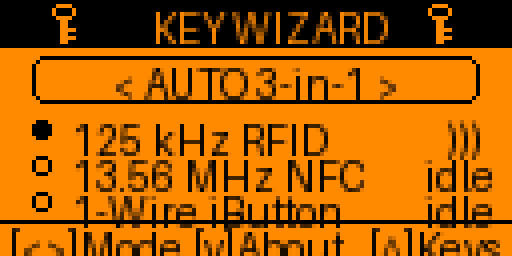

# Universal Key Wizard for Flipper Zero

<p align="center">
  <br>
  <b>All-in-One Intercom & Access Key Auto-Detector & Native Asset Sorter</b><br>
  <i>125 kHz RFID • 13.56 MHz NFC • 1-Wire iButton (Dallas, Cyfral, Metakom)</i><br>
  <i>All-in-One Intercom & Access Key Auto-Detector</i>
</p>

<p align="center">
  
  
</p>

---

## 🎯 Overview

Normally on the Flipper Zero, reading an unknown intercom key or access card requires guessing its technology and navigating between three separate applications:
- *125 kHz RFID*
- *NFC*
- *iButton*

**Universal Key Wizard** solves this by multiplexing all three readers simultaneously in high-speed round-robin mode. Simply touch **any key, fob, or card** to your Flipper, and Key Wizard will:
1. Instantly identify the technology and standard.
2. Decode its protocol and UID/ROM.
3. **Save it directly into Flipper's native system asset folders**:
   - 🏷️ **125 kHz RFID** &rarr; `/ext/lfrfid/<name>.rfid`
   - 💳 **13.56 MHz NFC** &rarr; `/ext/nfc/<name>.nfc`
   - 🔘 **1-Wire iButton** &rarr; `/ext/ibutton/<name>.ibtn`

The saved files are formatted according to official Flipper specifications and **immediately appear in your native Flipper apps** for reading, editing, and emulation!

---

## ✨ Features

- **True 3-in-1 Multiplexed Scanning**:
  - High-speed round-robin polling (~120ms LFRFID &rarr; ~120ms NFC &rarr; ~80ms iButton).
  - Works with all standard intercoms, fobs, smartcards, and Dallas pills.
- **Direct Native Folder Routing (No proprietary lock-in)**:
  - RFID keys go to `/ext/lfrfid/` as native `.rfid`.
  - NFC cards go to `/ext/nfc/` as native `.nfc`.
  - iButton pills go to `/ext/ibutton/` as native `.ibtn`.
  - Automatic collision-free naming (`Key_01`, `Card_01`, `Dallas_01`) using `storage_get_next_filename`.
- **Preloaded Universal / Master Keys**:
  - Press `[>]` to access a built-in library of popular universal master keys:
    - *Dallas DS1990 Universal* (`FF:FF:FF:FF:FF:FF:FF:01`)
    - *EM4100 Universal* (`00:00:00:00:00`)
    - *Cyfral Master*
    - *Mifare Classic Blank*
  - 1-click write to native assets without needing an external card.
- **Haptic & Audio Alerts**:
  - Distinct vibro patterns and melodies upon detection and successful save.
- **100% Native Built-in Hardware**:
  - No external boards, no soldering, no extra modules required.

---

## 🎮 Navigation & Controls

| Screen | Button | Action |
|---|---|---|
| **Scanning** | `[OK]` | Test Simulation Mode (cycles through RFID, NFC, iButton) |
| **Scanning** | `[>]` | Open Universal Quick Keys menu |
| **Scanning** | `[Back]` | Exit application |
| **Key Found** | `[OK]` | **Save directly to native asset folder** |
| **Key Found** | `[<]` or `[Back]` | Cancel and resume scanning |
| **Saved** | `[OK]` | Ready for next key |
| **Quick Keys** | `[^] / [v]` | Select master key |
| **Quick Keys** | `[OK]` | Save selected key to native folder |

---

## 🛠️ Building & Installing

### Prerequisites
Install `ufbt` (micro Flipper Build Tool):
```bash
pip install ufbt
```

### Build `.fap` Package
```bash
cd flipper-key-wizard
ufbt
```
The compiled package will be at `dist/key_wizard.fap`.

### Install to Flipper Zero
Connect your Flipper Zero via USB and run:
```bash
ufbt launch
```

---

## ☕ Support & Donations

If you find **Universal Key Wizard** useful and would like to support future development, hardware experiments, and firmware updates:

- **Bitcoin (BTC)**: `bc1q7fu5pck45x2v03e6yyqzf2hexu598s58c8zczg`

---

## 📜 License

MIT License. Created by Vazgen Grigoryan.
