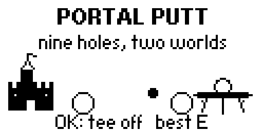
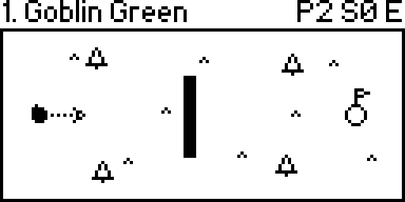
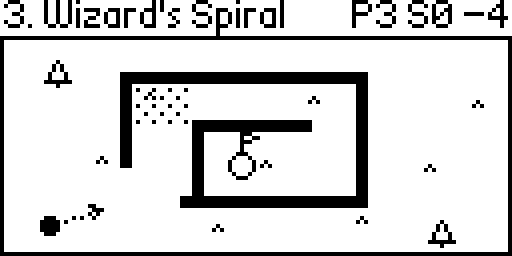
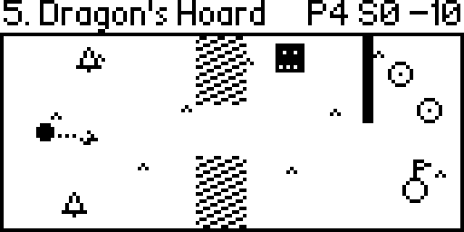
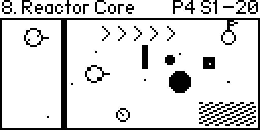
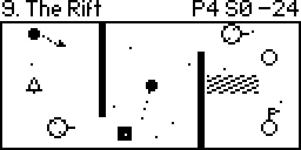
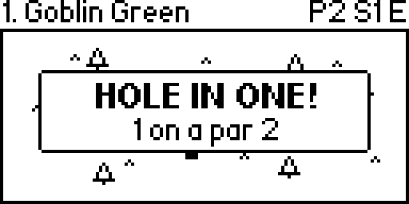
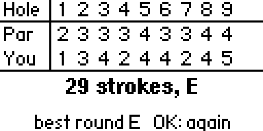

# Portal Putt

Minigolf for the Flipper Zero across two worlds: nine holes that alternate
between fantasy and sci-fi, with portals, gravity wells, lava rivers,
conveyors, crystal bumpers, a patrolling dragon and a tractor beam.

 

 

 

 

## The course

| # | Hole | Par | What is in the way |
|---|---|---|---|
| 1 | Goblin Green | 2 | A wall and four trees. |
| 2 | Docking Bay 9 | 3 | Two bulkheads and a conveyor that carries the ball along the bottom. |
| 3 | Wizard's Spiral | 3 | A walled spiral with a slime patch; the cup is in the innermost room. |
| 4 | Black Hole Bend | 3 | A gravity well in the middle of the green. Fall in and it costs a stroke. |
| 5 | Dragon's Hoard | 4 | A lava river with one bridge, and a dragon patrolling behind it. Crystal bumpers guard the cup. |
| 6 | Tractor Beam | 3 | A constant pull toward the top of the screen, and moon dust around the cup. |
| 7 | Faerie Ring | 3 | A ring of mushroom bumpers around the cup. |
| 8 | Reactor Core | 4 | You start in a sealed airlock; the only way out is the portal. A core bumper, a conveyor, a drone and coolant. |
| 9 | The Rift | 4 | Three lanes, a gravity well, a lava strip, a mover, and a portal shortcut that drops you right above the lava. |

Course par is 29. The stroke limit on a hole is par plus four.

## Controls

- Left / Right: turn the aim (hold to keep turning). Up / Down: nudge it by a quarter step
- OK: hold to charge, release to putt. The meter rises and falls, so the timing is the shot
- Back: pause (resume, scorecard, restart hole, quit)
- Every hole starts aimed at the cup; after each shot the aim resets to the cup

## How things behave

- Walls, trees and pods bounce the ball with a little energy lost. Bumpers bounce it with none lost and add some.
- Slime and moon dust quadruple the friction. Conveyors push the ball along their chevrons and will not let it stop.
- A gravity well pulls harder the closer the ball gets. Touch the centre and the ball is lost.
- Lava and the void are a penalty stroke; the ball goes back to where the shot started.
- Portals are paired. Enter one and the ball leaves the other in the direction of its tick mark at the same speed (at least a gentle roll), and cannot re-enter for half a second.
- Movers slide back and forth on a fixed cycle; time your shot.
- The cup takes the ball when it arrives slowly enough, and pulls it in from a couple of pixels out. Fast balls roll over it.

The best round is saved to `/ext/apps_data/portal_putt/best.bin`.

## Build

```
ufbt
ufbt launch
```

Host checks (no Flipper needed):

```
cc -O2 -o /tmp/solve tools/solve_test.c course.c sim.c -lm && /tmp/solve
cc -O2 -o /tmp/ace tools/ace.c course.c sim.c -lm && /tmp/ace 1
```

`solve_test` runs a beam search over shots and reports that every hole can be
sunk within par (it can, most of them in one). `ace` prints the most forgiving
hole-in-one on a hole as key presses and an OK hold time, which is how the
screenshot above was taken over RPC. Building with `-DPUTT_DEV` adds Right on
the hole intro to skip ahead and Up to jump to the scorecard, for screenshots.

Icon: `python tools/assets.py`.

## Layout

- `course.c`: the nine holes as walls and things
- `sim.c`: the ball physics, portable C with no Flipper dependencies
- `portal_putt.c`: drawing, input, sounds and the game flow

## What it transmits

Nothing. It uses the screen, the buttons, the speaker, the vibration motor, the LED and one small file on the SD card.
