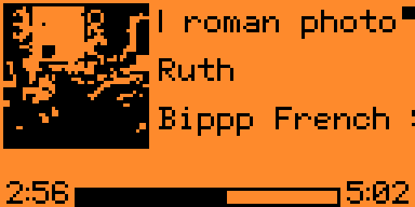
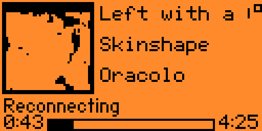

# Mac Media Remote

[English](README.md) | **Русский**

Показывает на Flipper Zero текущий медиапоток macOS по Bluetooth Low Energy: трек, исполнитель, альбом, прогресс и доступную обложку в контрастном постерном стиле. Работает с приложением или вкладкой браузера, если она публикует данные в системный Now Playing. Аудио остаётся на Mac. USB нужен только для установки приложения на Flipper.

## Требования

- Flipper Zero с официальной прошивкой 1.4.3 (API 87.1), включённым Bluetooth и картой microSD.
- Mac с Bluetooth и Swift toolchain.
- `nowplaying-cli`: `brew install nowplaying-cli`.

## Установка

```sh
sh scripts/build-flipper.sh # SDK прошивки 1.4.3 по умолчанию
sh scripts/build-mac.sh
```

Скрипт Flipper скачивает официальный SDK и кладёт FAP в `dist/`. Установите FAP через qFlipper по USB в `/ext/apps/Bluetooth/now_playing.fap`, затем откройте **Apps → Bluetooth → Now Playing**. Для разработки `./fbt launch APPSRC=now_playing` в каталоге SDK загружает и запускает FAP без обновления прошивки.

В терминале Mac запустите:

```sh
sh scripts/run-mac.sh
```

При первом запуске разрешите Bluetooth и подтвердите сопряжение на устройствах. После установки FAP кабель можно отключить. Выход с экрана Flipper: удерживать Back.

Если на Flipper остаётся `Waiting for Mac`, проверьте запрос с кодом сопряжения на его экране и подтвердите его кнопкой OK. После подтверждения компаньон должен подключиться автоматически.

## Управление

- OK: пауза/воспроизведение активного системного медиаплеера.
- Влево/вправо: предыдущий/следующий трек.
- Вверх/вниз: системная громкость Mac на 5%; удержание повторяет команду. Работает, когда выбранное аудиоустройство поддерживает программную регулировку.

Если приложение или браузер не публикует состояние в macOS Now Playing, его трек не будет виден. Позиция трека зависит от метки времени, которую источник передаёт в системный медиапоток. При потере Bluetooth соединение восстанавливается автоматически; старые данные на Flipper помечаются как `Reconnecting`.

## Экраны

Реальные кадры с подключённого Flipper; музыкальные экраны сняты во время воспроизведения Яндекс Музыки:

| Ожидание Mac | Воспроизведение | Другой альбом |
| --- | --- | --- |
|  |  |  |

| Следующий трек | Пауза | Переподключение |
| --- | --- | --- |
|  |  |  |

## Исходный код

Протокол описан в `protocol/constants.json`. Код Flipper адаптирован из `villenull/flipper-now-playing`; см. `THIRD_PARTY_NOTICES.md` и `LICENSE`.
