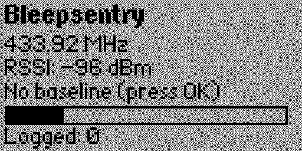
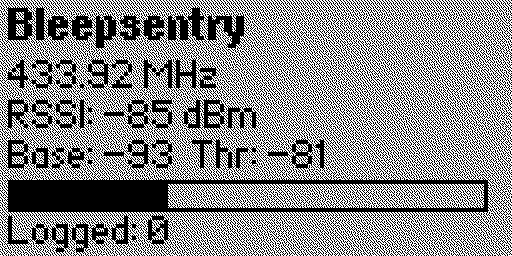
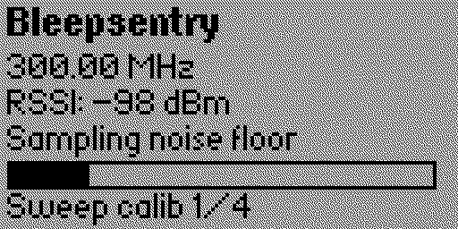
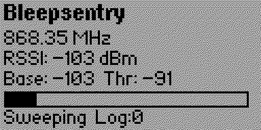

# Bleepsentry

[](https://github.com/hdyrawan/bleepsentry/actions/workflows/build.yml)

A passive RF sentry for the Flipper Zero. It learns the noise floor of a sub-GHz
frequency, then tells you the moment something transmits above it.

Receive only. The app never keys up the radio.

- **Red team and physical pentest**: sit on one known frequency, for example a
  gate or garage remote, and get a vibration plus a timestamped log entry when
  something transmits that you did not ask for.
- **TSCM and bug sweeps**: calibrate the four ISM bands it covers, then let the
  app cycle them the way a bug sweeper sweeps a room, logging every hit with its
  peak level and duration.

## Screenshots

| Idle, no baseline yet | Watch mode after calibration |
|---|---|
|  |  |

| Sweep mode calibrating band 1 of 4 | Sweep mode cycling the calibrated bands |
|---|---|
|  |  |

All four are 512x256 device captures in qFlipper's screenshot format: two colours
only, black foreground on the Flipper orange page. Capture details are in
[screenshots/README.md](screenshots/README.md).

## Install

With a Flipper connected over USB:

```
pip install ufbt
git clone https://github.com/hdyrawan/bleepsentry.git
cd bleepsentry
ufbt launch
```

`ufbt` builds the app, copies it to `/ext/apps/Sub-GHz/bleepsentry.fap` and
starts it. To install by hand, copy `dist/bleepsentry.fap` (produced by `ufbt`)
to `/ext/apps/Sub-GHz/` on the SD card, then open **Apps > Sub-GHz >
Bleepsentry** on the device.

Built against SDK API 88.2 and tested on official firmware 1.5.1.

## Controls

| Key | Action |
|---|---|
| `Up` / `Right` | Next frequency |
| `Down` / `Left` | Previous frequency |
| `OK` short | Calibrate the current frequency, then watch it |
| `OK` long | Calibrate all four frequencies, then sweep them |
| `Back` | Exit |

Switching frequency by hand drops you out of sweep mode and keeps any baseline
already calibrated for that frequency, so you can fall back to watching one band
without recalibrating it.

## How it works

1. **Calibrate.** The app samples RSSI on the selected frequency for 2 seconds
   (20 samples at 100 ms) and averages them into a baseline.
2. **Arm.** The alert threshold is that baseline plus 12 dB.
3. **Watch.** RSSI is polled every 100 ms. While it sits above the threshold the
   app vibrates once, shows `ALERT`, and tracks the peak level and the start
   time. When the level falls back under the threshold, the event is written to
   the log with its peak RSSI and duration.

**Watch mode** (short `OK`) does steps 1 to 3 on one frequency and stays there.
That is the red-team case: one known remote, one known band.

**Sweep mode** (long `OK`) calibrates all four frequencies in sequence, then
cycles them with a 1 second dwell on each, alerting and logging independently per
band. That is the TSCM case: four bands covered continuously instead of one.

The frequencies are 300.00, 433.92, 868.35 and 915.00 MHz. The on-screen meter
covers -115 to -25 dBm and the numeric readout is clamped to the same range, so
the number and the bar always agree.

## Log file

Every alert is appended to `/ext/apps_data/bleepsentry/log.csv`. The file is
created on first launch with a header row:

```
timestamp,freq_hz,baseline_dbm,threshold_dbm,peak_rssi_dbm,duration_s
1756949612,433920000,-92,-80,-71,3
```

| Column | Meaning |
|---|---|
| `timestamp` | Device RTC time when the alert started, epoch seconds |
| `freq_hz` | Frequency the alert was seen on |
| `baseline_dbm` | Calibrated noise floor for that frequency |
| `threshold_dbm` | Trigger level, baseline plus the 12 dB margin |
| `peak_rssi_dbm` | Strongest RSSI seen during the alert |
| `duration_s` | Seconds the signal stayed above the threshold |

Pull the file off the SD card with qFlipper, or read it on the device. The log is
appended, not overwritten, so a session keeps its history until you delete the
file yourself.

## Build and test

```
ufbt            # build; the .fap lands in dist/
ufbt lint       # SDK format and tidy checks
ufbt launch     # build, install, run
```

The threshold math, alert decision, index wrapping and CSV formatting live in
`bleepsentry_logic.c`, which has no Flipper SDK dependency so it can be tested on
a normal Linux machine:

```
cd tests
gcc -std=c11 -Wall -Wextra -I.. test_logic.c ../bleepsentry_logic.c -lm -o test_logic
./test_logic
```

That suite runs in CI alongside the firmware build, on both the `dev` and
`release` SDK channels.

## Hardware and limits

- Stock Flipper Zero only. No add-on boards, the on-board CC1101 does the work.
- Receive only: the app never transmits, so no region gating applies to it.
- While the app runs it owns the sub-GHz radio, so Flipper's own Sub-GHz app is
  unavailable until you exit with `Back`.
- The baseline is per frequency. Calibrating in a quiet room and then running in
  a noisy one will alert more, which is the intended behaviour.
- RSSI is a relative indication, not a calibrated power measurement. Use it to
  spot change over time, not to quote absolute levels.
- Closing the app remotely over RPC (`ufbt launch` while it is running) reports
  "has to be closed manually". That is expected for the plain `ViewPort` app
  pattern; a physical `Back` press exits cleanly.

## Why sub-GHz and not Bluetooth

The project started as a passive BLE scanner. The public SDK's BLE stack only
exposes peripheral and advertiser functionality, with no central or observer
scan API and no advertisement-received event, so passive BLE scanning is not
buildable against official firmware. Sub-GHz is, because `furi_hal_subghz`
exposes RSSI readout and async receive, which is what this app uses.

## Intended use

Authorized security work only: penetration tests, red team exercises, TSCM and
bug sweeps under contract, or sweeping spaces you own. The app only listens.

## Status

v1.1. Verified on hardware with official firmware 1.5.1 (API 88.2): install,
launch, Watch calibration, full Sweep calibration and cycling, clean exit with
`Back`. Submitted to the Flipper Apps Catalog.

## License

GPL-3.0. See [LICENSE](LICENSE). Changes are listed in [changelog.md](changelog.md).
