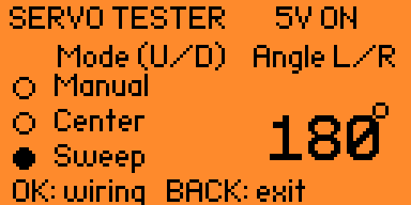

# Servo Tester for Flipper Zero


This version combines the uploaded app's mode-and-angle layout with a short wiring screen and automatic control of the GPIO 5 V rail.

## On-device controls

- Up / Down: choose Manual, Center or Sweep.
- Left / Right in Manual: change the angle by 10 degrees.
- OK: open or close the wiring screen.
- Back: leave the wiring screen, or stop the app from the main screen.

Center moves to 90 degrees. Sweep alternates between 0 and 180 degrees, holding each endpoint for 2 seconds before moving to the other. The displayed angle is a nominal position; a servo's actual range varies by model.

## Wiring

- Pin 1 (+5 V): servo power
- Pin 2 (PA7): servo signal; 3.3 V logic
- Any GND pin: servo ground

The app enables Flipper's GPIO 5 V rail when needed, and turns it off on exit only if the app enabled it. The 5 V rail is rated up to 1.2 A. For an external servo supply, connect its ground to Flipper GND. Use an external supply if the servo's current demand is too high for the Flipper.

## Build and install

The included `.fap` was built with the official Flipper firmware SDK 1.5.1 (API 88.2). Copy `gbhobbytech_servo_tester.fap` to the SD card at `apps/GPIO/`, installing it as a separate app, then open **Apps → GPIO → Servo Tester**. If Flipper reports an SDK mismatch, update its firmware or rebuild the source against the SDK on the device.

To rebuild from this folder, install `ufbt` and run:

```sh
ufbt
```

The upstream Servo Tester app is by M. Hasbini and is MIT licensed. This adaptation keeps the mode-and-angle interface and adds wiring help, managed 5 V output and a longer sweep dwell.

## Testing feedback

Servo travel varies between models. With the author's MG90S, version 0.5 currently gives about 90 degrees of physical travel.

If you test Servo Tester, please [open a GitHub issue](https://github.com/gbhobbytech/flipper-servo-tester/issues/new) and include:

- Servo make and model
- Flipper firmware version
- Power source: Flipper 5 V pin or external supply
- Approximate travel at the app's 0 and 180 degree settings
- Any buzzing, stalling or other unusual behaviour

Avoid holding a servo against its mechanical end stops.
