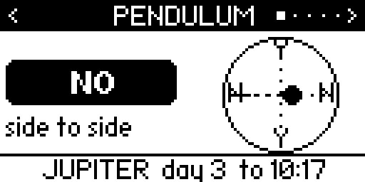
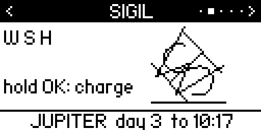
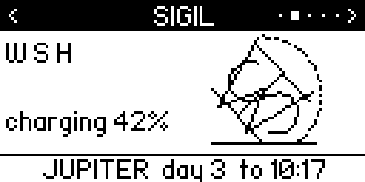
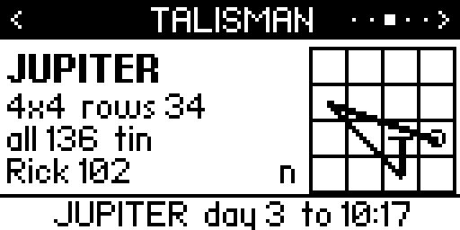
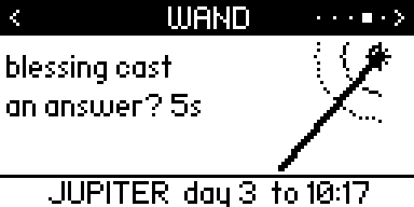
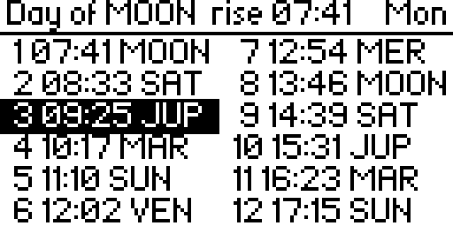

# Grimoire

A pendulum, a sigil, a talisman and a wand for the Flipper Zero: the one place
a spell from [rickseufert.com](https://rickseufert.com) can leave the browser.
Claimed from [rseufert.github.io#147](https://github.com/rseufert/rseufert.github.io/issues/147).

 

 

 

All five pages are in. Left and Right turn the pages.

| Page | What it does | Site issue |
|---|---|---|
| **Pendulum** | Hold a question in mind and press OK. The bob wanders, then settles: to and fro is yes, side to side is no, round and round means ask again. The answer comes from the hardware random source. A tick sounds at each end of the swing. | |
| **Sigil** | Press OK and type a wish on the Flipper's keyboard. Spare's reduction strikes the vowels and every repeated letter; the rest are drawn from stroke skeletons, each turned to one of eight directions, scaled, sometimes flipped and set off centre by a generator seeded from the wish, and bound with a ring (four letters or more) or a bar. The site's `temple/sigil.js` does exactly this, so a wish gives the same sigil here as there (`tools/sigil_check.js` proves it). Hold OK for four seconds to charge it: the strokes shake, a tone climbs two octaves, the LED heats. At full charge it burns to ash and is gone. Nothing is stored. | [#141](https://github.com/rseufert/rseufert.github.io/issues/141) |
| **Talisman** | Agrippa's square of the current hour's planet (Up and Down pick another), with the sigil of its intelligence traced solid, of its spirit dotted, and, after holding OK to type one, a name of yours in a thick line by his Latin numeration. OK cycles the three. A ring marks the start of a trace and a bar the end; a number too big for the square is read with its last figure dropped until it fits, as the old sigils were made. The data and the rules are the site's `temple/talisman.js`. | [#143](https://github.com/rseufert/rseufert.github.io/issues/143) |
| **Wand** | Listens on 433.92 MHz (Up and Down for 315, 868.35 or 915). OK casts a blessing: five frames carrying the planetary hour, with a rising sweep from the speaker, then five seconds of waiting for an answer. A second Flipper on this page hears the blessing, shows whose hour it was cast in, and answers it after half a second; the caster sees ANSWERED. Where the region forbids transmitting the wand says so and stays quiet. The frame is documented below so an RTL-SDR page on the site can read it too. | |
| **Hours** | Today's table of planetary hours, twelve per screen; Up and Down flip between the day and the night. The current hour is marked. | [#140](https://github.com/rseufert/rseufert.github.io/issues/140) |

## The hour

Every page's footer names the planetary hour: whose it is, which of the twelve
of the day or the night, and when it ends. From sunrise the hours belong to
Saturn, Jupiter, Mars, the Sun, Venus, Mercury and the Moon in rotation, the
day's first hour names the day, and day and night hours are each a twelfth of
the daylight or the dark. `hours.c` computes sunrise and sunset with NOAA's
formulas for the same place and constants as the site's `js/hours.js`
(Portland, with the United States daylight-saving rule); the Flipper's clock
is taken as local time.

## The wand's frame

On-off keying, pulse-width coded, 400 microsecond unit:

| part | high | low |
|---|---|---|
| sync | 2000 us | 6000 us |
| bit 1 | 1200 us | 400 us |
| bit 0 | 400 us | 1200 us |
| tail | 400 us | 4000 us |

Thirty-two bits follow the sync, most significant first: magic `0xB7` (8),
kind (1: 0 a blessing, 1 an answer), planet (3, in the Chaldean order Saturn
to Moon), day (1), hour index 1 to 12 (4), minute of the local day (11), and
a check (4): the sum of the seven nibbles before it, modulo 16. Each frame is
sent five times. `wand.c` encodes and decodes it and `tools/wand_test.c`
round-trips 280 frames through twenty percent timing jitter and noise.

## Checking the engines on a host

The three engines have no Flipper dependencies, and each has a check:

```
cc -Wall -o /tmp/hours_test tools/hours_test.c hours.c -lm && /tmp/hours_test
cc -Wall -o /tmp/talisman_test tools/talisman_test.c talisman.c hours.c -lm && /tmp/talisman_test
cc -Wall -o /tmp/sigil_test tools/sigil_test.c sigil.c -lm && /tmp/sigil_test "the wish"
cc -Wall -o /tmp/wand_test tools/wand_test.c wand.c && /tmp/wand_test
node tools/sigil_check.js path/to/temple/sigil.js "the wish"
```

The first compares sunrise, sunset and hours with published Portland times
and the classic table; the second checks every square's rows, columns,
diagonals and contents and the names' numbers; the last two print a sigil's
strokes from the C and from the site's own JavaScript for the same wish, and
the outputs are identical to four decimals.

## Controls

- Left / Right: switch page
- OK: Pendulum: ask. Sigil: write a wish. Talisman: next trace. Wand: cast
- Hold OK: Sigil: charge. Talisman: write a name
- Up / Down: Talisman: another planet. Wand: another frequency. Hours: day or night
- Back: exit

## Building

Needs [ufbt](https://github.com/flipperdevices/flipperzero-ufbt). Run `ufbt` in
this directory and the app lands in `dist/`. `ufbt launch` installs it on a
connected Flipper. `tools/assets.py` regenerates the icon.

## What it transmits

Only the Wand, only when you press OK or when it answers a blessing it has
heard, and only where the firmware's regional settings allow: five short
OOK frames, about a third of a second in all. Everything else is receive-only
or touches no radio at all.

## Sources

Austin Osman Spare, *The Book of Pleasure* (1913). Agrippa, *Three Books of
Occult Philosophy* II.22 and II.34. Both public domain.

## License

MIT. See [LICENSE](LICENSE).
