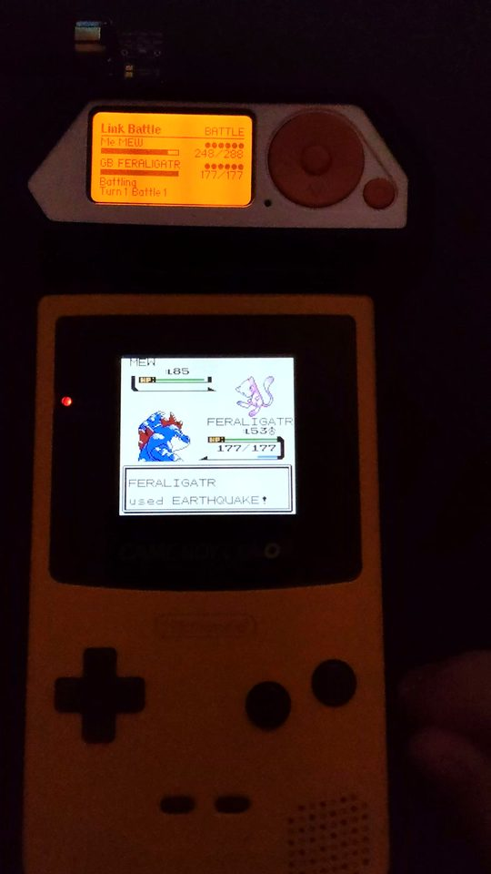
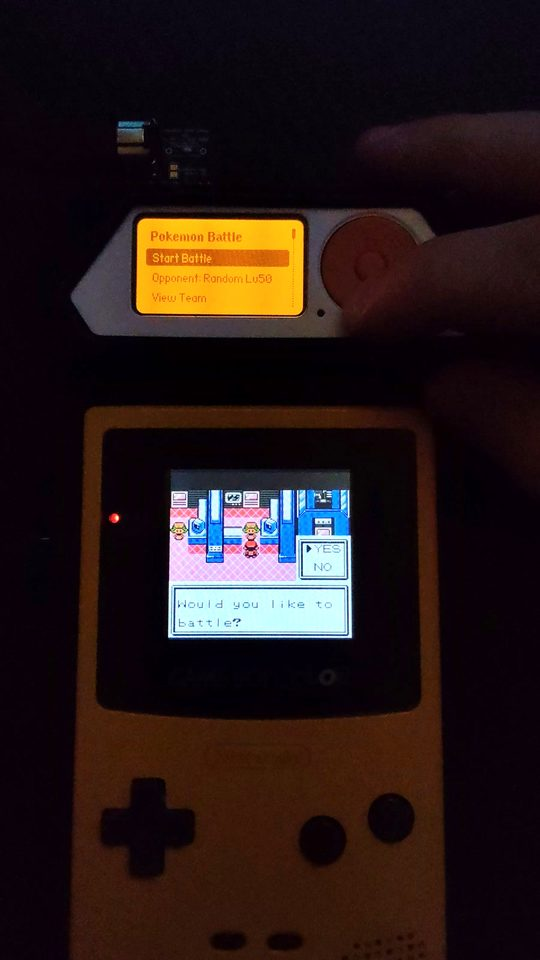
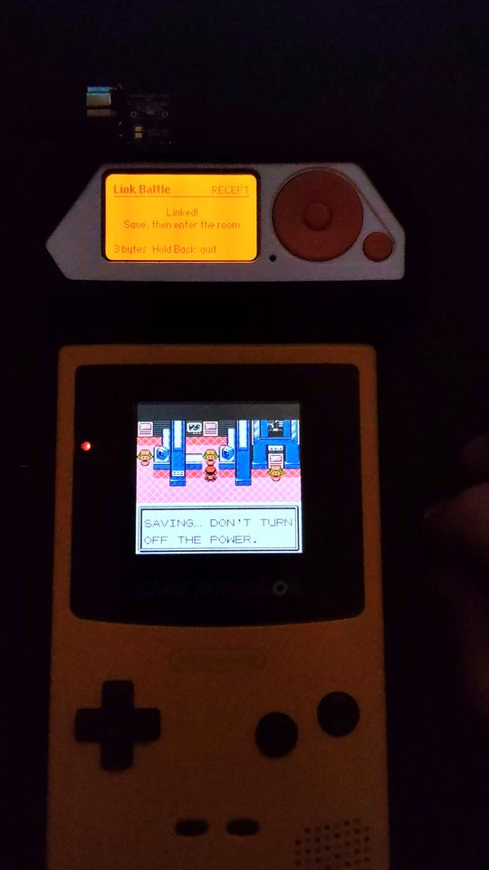
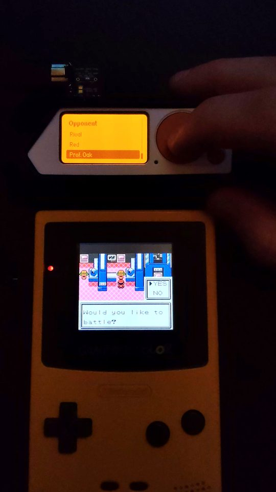
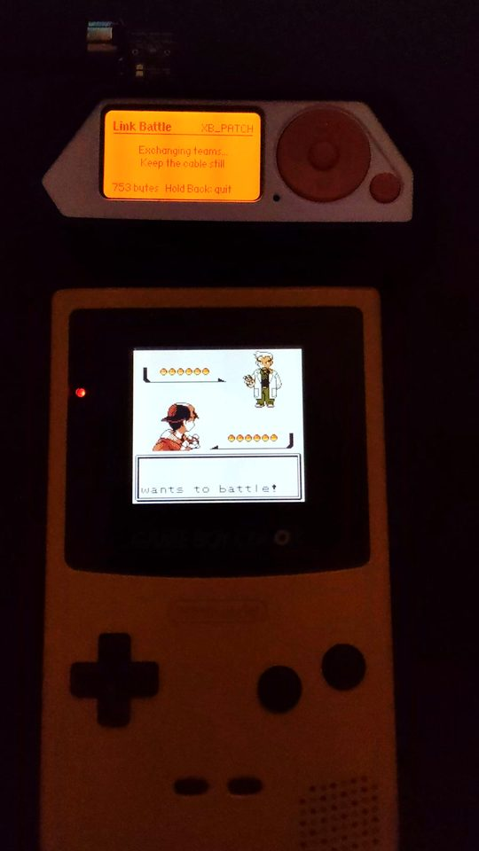

# Pokémon Crystal Battle Trainer for Flipper Zero

[](https://github.com/cycalo/Flipper-Zero-Game-Boy-Pokemon-Battle/actions/workflows/build.yml)
[](LICENSE)

Battle your Pokémon Crystal team against a Flipper Zero. The Flipper plays the **second Game
Boy** in a Cable Club **Colosseum** link battle: plug it into a Game Boy Color with a link cable,
pick an opponent (a random team, any Gym Leader, the Elite Four, Lance, your Rival, Red or Prof.
Oak) and fight it in the real game, with a battle AI choosing the Flipper's moves.

<p align="center">
  
  
</p>

## Features

- Real link battles against an unmodified Pokémon Crystal cartridge on a Game Boy Color
- **Opponents:** random teams in any level range, or Crystal's boss teams (all 16 Gym Leaders,
  Elite Four, Champion Lance, Rival, Red, Prof. Oak) with hand-picked held items and optional level
  scaling
- **Battle AI** that uses the game's damage formula, goes for KOs, uses status, boosts and recovery,
  and switches out of bad matchups
- **Battle music and trainer picture** on the Game Boy follow the opponent (Red gets the Champion
  theme and his own sprite), or can be set by hand
- **View Team** with sprites, levels, held items and moves
- Pinout picker for common link-cable adapters
- A log of every battle on the SD card, replayable on a PC

## What you need

- A Flipper Zero on [official firmware](https://flipperzero.one/update) **Release** (or matching
  API). This tree builds against official `release` (verified on 1.5.1 / API 88.2). Custom
  firmware such as [Momentum](https://momentum-fw.dev/) also works when its API matches the FAP.
- A Game Boy Color with **Pokémon Crystal** (US/Europe). Your save must have
  reached a Pokémon Center 2F, where the Cable Club is.
- A way to connect a Game Boy link cable to the Flipper's GPIO header. This project was built and
  tested with KBEmbedded's
  [Game Link GPIO Module for Flipper Zero](https://www.tindie.com/products/kbembedded/game-link-gpio-module-for-flipper-zero-game-boy/),
  which works with the default **Original** pinout. A cut-in-half link cable wired to the GPIO pins
  also works (set its pins under **Pinout**).

<p align="center">
  
</p>

## Install

Download `pkmn_battle.fap` from the latest
[build](https://github.com/cycalo/Flipper-Zero-Game-Boy-Pokemon-Battle/actions/workflows/build.yml) and copy it to
`SD/apps/GPIO/` on the Flipper, or build it yourself (see [Building](#building-the-flipper-app)).
It appears as **Apps → GPIO → [GBC] Pokemon Battle**.

## Playing

1. Connect the link cable. If your adapter isn't the default, pick it under **Pinout**.
2. Choose **Opponent** (the choice is saved), then **Start Battle**. The screen shows `CONN` /
   "Talk to Colosseum desk".
3. In Crystal, go to a Pokémon Center 2F and talk to the **right-hand** (Colosseum) receptionist.
   Answer Yes and save when asked.
4. Walk into the Colosseum and press A at the console. The teams are exchanged and the battle
   starts.
5. The Flipper shows both active Pokémon (HP, status, party), its last move and the turn. After a
   battle, use the console again for a rematch. Hold **Back** to quit (it asks first; quitting
   mid-battle leaves the Game Boy waiting).

### Main menu

| Item | What it does |
| --- | --- |
| **Start Battle** | Waits for the Game Boy and plays the battle |
| **Opponent** | Random Battle (with its level range) or a boss team |
| **View Team** | One Pokémon per page: sprite, level, item, moves. Left/Right pages; for random teams, OK draws a new team |
| **Music** | Battle theme on the Game Boy. *Default* follows the opponent; or force Champion, Gym, Rival, Rocket, Trainer, Wild or Suicune |
| **Picture** | Trainer sprite on the Game Boy. *Default* follows the opponent, *Link* keeps the normal link picture, or force a trainer class |
| **Pinout** | Link-cable adapter wiring |
| **Reset to Default** | Clears all saved settings |

### Opponents

- **Random Battle:** six random species in the level range you set (for example 75-80), each with a
  sensible moveset (STAB, coverage, status/boost/recovery, pairs like Rest + Sleep Talk) and a held
  item. Every move is legal in Crystal at that level (level-up moves of the species and its
  pre-evolutions, TMs/HMs, move tutors, egg moves). Species only appear at levels they can exist at
  (Dragonite and Tyranitar from 55) and not far past when they would have evolved. Each rematch
  brings a new team.
- **Bosses:** Gym Leaders (all 16), Elite Four (Will, Koga, Bruno, Karen), Champion Lance, Rival
  (Indigo Plateau team, chosen by the rival's starter), Red and Prof. Oak. Their teams are exactly
  as in Crystal (species, levels, moves, trainer DVs), and each Pokémon holds a hand-picked item (in
  the retail game they hold none). Levels can stay as in the game or scale so the ace is level
  50-100.

<p align="center">
  
  
</p>

### Good to know

- The Game Boy's team may use any move and item. The Flipper's teams never use Beat Up.
- A few Crystal bugs can desync even two real Game Boys. When one comes up the Flipper shows
  "Desync risk: game bug"; see [docs/PORTING.md](docs/PORTING.md).
- Battle logs are written to `SD/apps_data/pkmn_battle/logs/*.pbl`.

## How it works

In a Gen II link battle the two Game Boys never exchange battle state. Each one runs the whole
battle engine locally from a shared random seed and only sends a one-byte action per turn. So the
Flipper runs a **bit-exact C port of Crystal's battle engine** in lockstep with the Game Boy: every
damage roll, critical hit and miss has to come out exactly the same on both sides. The AI only
reads the engine's state, so nothing it decides can desync the link.

- [Link protocol notes](docs/PROTOCOL.md): Colosseum handshake, byte blocks, the per-turn exchange
- [Engine porting notes](docs/PORTING.md): what is ported, how it is verified, known game desyncs

## Development

### Layout

| Path | Contents |
| --- | --- |
| `application.fam`, `app/` | Flipper app: scenes, views, link/storage/engine glue |
| `lib/pkb_core/` | Portable C11 core: battle engine, link session, team generator, AI |
| `lib/pkb_core/gen/`, `files/` | Data tables generated from pokecrystal; sprites and movepools |
| `lib/flipper-gblink/` | Game Boy link library (submodule, BSD-2) |
| `host/` | PC build: unit tests, simulators, SameBoy emulator harness, log tools |
| `tools/` | Table generators, log/party decoders, FAP size gate |

### Building the Flipper app

Requires Python 3 and [ufbt](https://github.com/flipperdevices/flipperzero-ufbt). The SDK is kept
project-local, so a globally installed one is left alone:

```bash
git submodule update --init lib/flipper-gblink
python -m ufbt dotenv_create
python -m ufbt update
python -m ufbt
```

For Momentum firmware, point ufbt at Momentum's index instead:

```bash
python -m ufbt update --index-url=https://up.momentum-fw.dev/firmware/directory.json
python -m ufbt
```

Output: `dist/pkmn_battle.fap`. `python -m ufbt launch` installs and starts it over USB.

### Host tests

Requires CMake, Ninja, clang (on Windows: LLVM-MinGW) and Python 3.

```bash
cmake -G Ninja -B build-host
ninja -C build-host
ctest --test-dir build-host --output-on-failure
```

The tests include a link session against a simulated Game Boy (`host/sim/master_sim.c`), tens of
thousands of self-play battles that must mirror every turn, AI checks, a party-block cross-check
against an independent Python decoder, and a check that regenerating the data tables from
pokecrystal produces no diff.

Decode an SD log with `python tools/gen/decode_log.py <file.pbl>`, and re-run it through the
engine with `build-host/host/replay_log <file.pbl>` (every exchange and its state CRC must match).

### Emulator harness

`pkb_harness` (built with the host tests) runs a real Crystal ROM in
[SameBoy](https://github.com/LIJI32/SameBoy) and links it to the Flipper's session, or to a second
emulated Game Boy. You need your own ROM (US/Europe 1.0, the one pokecrystal builds) and a battery
save made **facing the Colosseum receptionist** in a Pokémon Center 2F. Keep both in `local/`
(gitignored). Symbols come from `tools/gen/fetch_pokecrystal.py`.

```bash
git submodule update --init host/third_party/SameBoy
H=build-host/host/harness/pkb_harness
$H fixture --rom local/crystal.gbc --sav local/crystal.srm --out local/colosseum.state
$H run    --rom local/crystal.gbc --state local/colosseum.state --battles 3 --out local/runs
$H replay SD_LOG.pbl --rom local/crystal.gbc --state local/colosseum.state
$H golden --rom local/crystal.gbc --state local/colosseum.state --seed 1
```

| Command | What it does |
| --- | --- |
| `fixture` | Turns the save into a state standing at the Colosseum desk |
| `run` | GB vs the Flipper's battle logic; writes device-style battle logs |
| `replay` | Re-runs a hardware log; every exchange must match |
| `golden` | Same battle against our session and against a second GB; byte streams must agree |
| `shadow` | Two GBs with random parties; engine WRAM must match the real game every exchange |
| `engine` | Device-like setup with mirror checks; logs must reproduce under `replay_log` |

Options: `--dump DIR` (PPM screenshots), `--trace FILE` (link byte trace). To run the harness as
ctest tests:

```bash
cmake -B build-host -DPKB_ROM=local/crystal.gbc -DPKB_SAV=local/crystal.srm -DPKB_REPLAY_LOGS=local/logs
ctest --test-dir build-host -L harness
```

### Regenerating the data tables

`lib/pkb_core/gen/` and `files/movepools.bin` are generated from pret/pokecrystal at the revision
pinned in `tools/gen/pokecrystal.lock` (fetched into `tools/gen/.cache/`):

```bash
python tools/gen/gen_tables.py
python tools/gen/gen_movepools.py
```

## Acknowledgments

- [Flipper-Zero-Game-Boy-Pokemon-Trading](https://github.com/kbembedded/Flipper-Zero-Game-Boy-Pokemon-Trading)
  by [KBEmbedded](https://github.com/kbembedded), with contributions from ProteanReverie, shaped
  the Flipper-side link approach and supplied the hand-made Pokémon sprites in
  `files/all_sprites.fxbm`. Thank you.
- [flipper-gblink](https://github.com/kbembedded/flipper-gblink) by KBEmbedded (BSD-2), the Game
  Boy link library behind all of this app's link-cable I/O and pinout settings (included as a
  submodule in `lib/flipper-gblink/`).
- KBEmbedded's [Game Link GPIO Module for Flipper Zero](https://www.tindie.com/products/kbembedded/game-link-gpio-module-for-flipper-zero-game-boy/),
  the hardware this project was developed and tested on.
- [pret/pokecrystal](https://github.com/pret/pokecrystal), from which the battle engine and data
  tables are derived.
- [SameBoy](https://github.com/LIJI32/SameBoy) (MIT) for the emulator tests.

## License

MIT, see [`LICENSE`](LICENSE).

The battle engine port and its data tables are derived from pokecrystal, which has no license; the
underlying game data belongs to Nintendo / Game Freak / The Pokémon Company. No ROM content ships
beyond game-data tables; the emulator harness needs your own legally dumped ROM.

Not affiliated with or endorsed by Nintendo, Game Freak or The Pokémon Company.

Questions, bugs and contributions: [open an issue](https://github.com/cycalo/Flipper-Zero-Game-Boy-Pokemon-Battle/issues).
