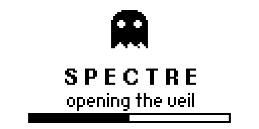
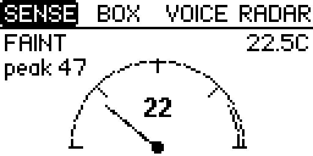
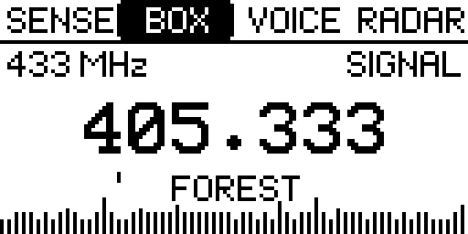
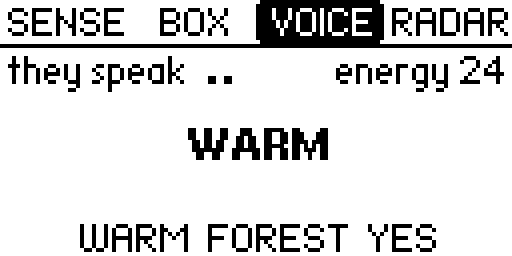
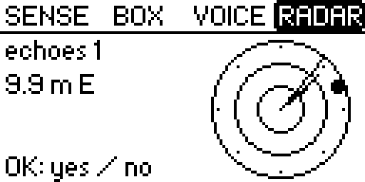
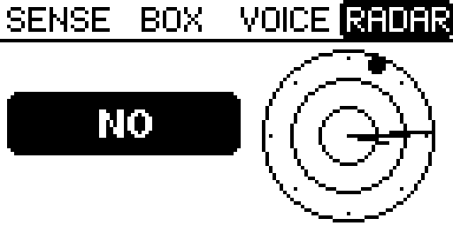

# Spectre

A ghost hunting kit for the Flipper Zero: an EMF-style needle, a spirit box,
a spirit voice and a radar, all driven by one shared "spirit energy" level.

 

 

 

It is a toy. The energy level is fed by real inputs where the hardware has
them, and by the hardware random number generator for the rest. Nothing here
detects anything that is not already in the room.

## Tabs

| Tab | What it does |
|---|---|
| **SENSE** | A needle gauge from QUIET to CONTACT. Real inputs: a nearby NFC or 125 kHz reader field pushes it hard, a drop in the battery temperature since you started reads as a COLD SPOT. Geiger crackle that quickens as the needle climbs. |
| **BOX** | A spirit box. Sweeps a Sub-GHz band in 64 steps, draws the noise floor as a ribbon and plays the channel hopping as bursts of static. When something real is on the air it locks on, the tone wavers, and a word comes through. |
| **VOICE** | A spirit voice. Words arrive on their own when the energy surges, spelled out letter by letter with a garbled syllable each. Press OK to ask a question and wait for the answer. The last three words stay on screen. |
| **RADAR** | A sweeping scope with echoes that drift, the nearest one's range and bearing, and a ping as the beam crosses each. Press OK for a yes or no. |

Every surge flashes the screen, buzzes, and the LED breathes in the tab's
colour, brighter the more excited the kit gets.

## Controls

- Left / Right: switch tab
- Up / Down: BOX: change band (300, 433 or 868 MHz)
- OK: SENSE: reset the baseline and peak. BOX: hold the sweep. VOICE and RADAR: ask
- Hold OK: sound on or off
- Back: exit

## What it transmits

Nothing. Sub-GHz is receive-only. SENSE listens for reader fields with the
NFC and RFID front ends in their passive detect modes; it does not power a coil.

## Building

Needs [ufbt](https://github.com/flipperdevices/flipperzero-ufbt). Run `ufbt`
in this directory and the app lands in `dist/`. `ufbt launch` installs it on a
connected Flipper. `tools/assets.py` regenerates the icon and the boot ghost.

## License

MIT. See [LICENSE](LICENSE).
