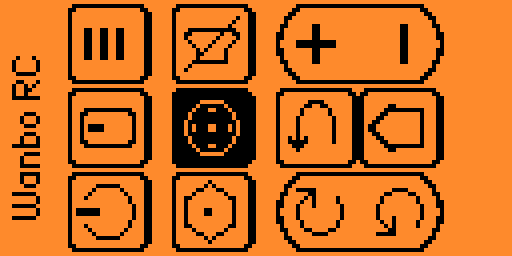

# Wanbo RC

## Screenshots

### Main screen



### D-Pad mode


Wanbo RC is an infrared remote control app for the Flipper Zero, designed for the Wanbo's projectors: DaVinci 1, MINI, X1, X2, X5, NEWT2MAX, T4, T6R1G, Mozart 1.

The app provides a vertical remote-control layout with dedicated buttons for power, mouse mode, menu/options, setup, mute, focus, return, home, volume control, and a dedicated D-Pad mode.

## Features

* Infrared remote control for Wanbo projector
* Vertical layout designed for one-handed use
* Icon-based interface
* Dedicated D-Pad mode
* Volume up and down controls
* Focus up and down controls
* Return and Home shortcuts
* NEC infrared protocol support

## Controls

### Main screen

Use the Flipper Zero directional pad to navigate between the buttons. Press OK to send the selected infrared command.

### D-Pad mode

Select the D-Pad icon and press OK to enter D-Pad mode.

In D-Pad mode, the Flipper is intended to be held vertically with the infrared transmitter pointing toward the projector.

* Physical Left sends Up
* Physical Right sends Down
* Physical Down sends Left
* Physical Up sends Right
* OK sends OK
* Short Back sends Return
* Long Back returns to the main screen

## Supported device

Tested with:

* Wanbo DaVinci 1 projector

Other Wanbo projectors may work if they use the same infrared protocol and command set, but they have not been tested.

## Installation

After the app is available in the Flipper Apps Catalog, it can be installed through the Flipper Mobile app or Flipper Lab.

## Development

This app is built as an external Flipper Zero application using uFBT.

To build locally:

```bash
ufbt update
ufbt -c
ufbt
```

The compiled `.fap` file will be generated in the `dist/` folder.

## Author

Yuri Monteiro
