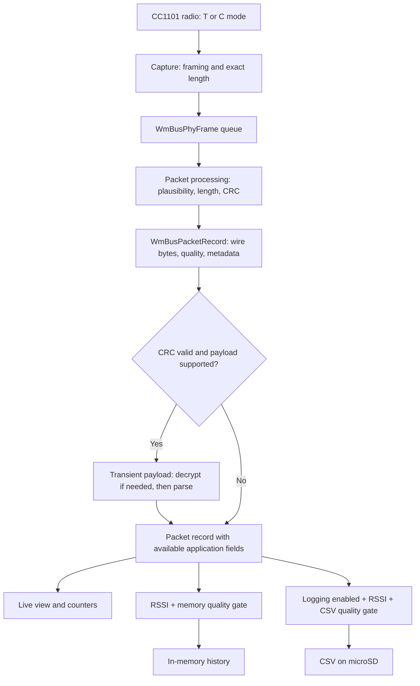

# Development

Build instructions and user controls are in the [README](../README.md).

## Architecture

The app separates radio reception from packet processing. The radio thread
drains the CC1101 receive FIFO and reconstructs frames. A separate processing
worker validates each frame, resolves its application payload, runs the parsers,
and sends the result to the UI and storage.



### From radio bytes to a packet

1. **Capture establishes the frame boundary.** In T mode, capture decodes
   3-of-6 symbols into a Frame A telegram. In C mode, it validates and removes
   the remaining sync bytes, then produces Frame A or B. Both paths check the
   expected length and produce a `WmBusPhyFrame` starting at the link-layer
   L-field. Invalid framing and incomplete captures are discarded here.
2. **The radio hands off the frame.** A bounded queue lets the radio resume
   reception while the worker processes the packet. If the queue fills, the new
   frame is dropped and the drop count is reported. Settings and key updates
   use the same queue, giving each frame a coherent processing configuration.
3. **Packet processing assigns a quality level.** Plausibility, length, and CRC
   checks determine how much of the frame can be trusted. Complete frames yield
   identity and protocol metadata. A failed CRC prevents application parsing,
   but the packet can still reach the live view and qualify for retention.
4. **Supported payloads are parsed.** For CRC-valid frames, the worker uses
   the normalized frame with link-layer CRC bytes removed. It resolves the
   application payload and decrypts supported Mode 5 payloads when a configured
   key succeeds. Registered parsers then try to extract application fields.
   Unsupported payloads or unsuccessful decryption retain the frame metadata.
5. **The app routes the result.** Every processed record updates live state and
   counters. History and CSV each apply their retention policy before saving.

See [Receive Pipeline](receive-pipeline.md) for the radio presets, FIFO
handling, mode-specific framing, and supported length range.

### Data ownership

`WmBusPacketRecord` is the shared result passed from processing to the app. It
contains reception metadata, quality, identity, protocol headers, application
fields, and the authoritative **link-layer wire bytes**. These bytes include
link-layer CRCs and retain any encrypted payload; they exclude radio sync and
T-mode 3-of-6 coding.

Normalization happens during frame validation. The normalized frame and any
decrypted payload live in temporary worker buffers. Parsers access the resolved
application payload and packet metadata through `WmBusParserPacketView`. The
extracted fields and decryption status are added to the record; the temporary
payload buffers are not retained.

History keeps compact entries with a wire-byte preview. **Full CSV** writes the
complete wire bytes as hex alongside metadata and decoded fields; **Basic CSV**
writes a smaller summary.

### Quality and retention

Quality progresses through **Received → Header OK → Frame complete → CRC OK →
Decoded**. A packet reaches **Decoded** only when an application parser succeeds.

The `MEM gate >=` and `CSV gate >=` settings select independent minimum quality
levels. Both use the same optional RSSI threshold. These gates control saving;
packets below either threshold still update live state and counters. History is
held in memory, while CSV logs persist on the microSD card.

### Source map

| Location | Responsibility |
| --- | --- |
| [`src/app/`](../src/app/) | App lifecycle, processing queue, and routing results to UI and storage |
| [`src/app/radio/`](../src/app/radio/) | CC1101 configuration, FIFO service, and RX recovery |
| [`src/protocol/capture/`](../src/protocol/capture/) | Mode-specific FIFO framing and `WmBusPhyFrame` construction |
| [`src/protocol/frame/`](../src/protocol/frame/) and [`decode/`](../src/protocol/decode/) | Frame lengths, CRC handling, normalization, and decoding helpers |
| [`src/protocol/packet/`](../src/protocol/packet/) and [`crypto/`](../src/protocol/crypto/) | Packet quality, metadata, payload resolution, and Mode 5 decryption |
| [`src/protocol/parser/`](../src/protocol/parser/) and [`model/`](../src/protocol/model/) | Parser registry, device parsers, and application records |
| [`src/protocol/format/`](../src/protocol/format/) | Packet and application-field presentation |
| [`src/ui/`](../src/ui/) | Scenes, live display, compact history, and packet details |
| [`src/storage/`](../src/storage/) | Settings, keys, and CSV files |
| [`src/test/`](../src/test/) | Opt-in on-device selftests |


## Parsers

Parsers run in the following order. The first successful parser supplies the
application fields, so device-specific parsers precede the generic fallback.

| Parser | Handles |
| --- | --- |
| `QWaterV2` | Qundis QWater v2 WalkByDataSet telegrams |
| `Apator162` | Supported Apator short-TPL telegrams |
| `DifVif` | Standard DIF/VIF application records |

### Adding a parser

New parsers live under `src/protocol/parser/`.

1. Add a parser ID in `src/protocol/model/wmbus_application_types.h`.
2. Implement `parse(const WmBusParserPacketView*, WmBusPacketApplicationData*)`.
   Return `false` when the packet does not match or cannot be safely interpreted.
3. Add its display name to the indexed table in `wmbus_parser.c`.
4. Include and register it in `wmbus_parser_registry.c` with its `parser_id`,
   before any broader parser it should override.
5. Add or update selftests in `src/test/`.

`WmBusParserPacketView` exposes data-link (DLL), transport (TPL), payload, and
identity data from the shared packet pipeline. New parser tests should exercise
the full path through `wmbus_packet_process_phy_frame(...)` so they also cover
framing, security checks, and parser selection.


## Protocol Sources

- EN 13757-3 and EN 13757-4 are normative for supported WM-Bus frame, transport, and security behavior.
- EN 13757-7 defines transport-layer security; Mode 5 follows its address/access-number IV and decryption-verification field.
- OMS documents are used only for extensions they define.
- The [TI CC1101 errata](https://www.ti.com/lit/er/swrz020e/swrz020e.pdf) is authoritative for RX FIFO handling.
- Proprietary Apator behavior is maintained from tested packet fixtures.

Application decoding accepts the supported variable-data CI values `72`, `7A`,
and `78`. Unsupported VIF modifiers and record errors remain uninterpreted.
Other services retain frame metadata without speculative application
parsing. QWater WDS extraction follows DIF/VIF record boundaries.


## Tests

Parser selftests live in separate `src/test/wmbus_selftest_parser_<parser>.c` files
for `qwaterv2`, `apator162`, and `dif_vif`. Each file exposes its own check list,
registered in `wmbus_selftest_runner.c`. Shared packet/security integration checks
live in `wmbus_selftest_packet.c`; reusable fixtures and helpers stay in
`wmbus_selftest_support.c`.

Normal builds exclude the on-device test suite. Build, deploy, and run the test variant with:

```bash
WMBUS_SELFTESTS=1 ufbt launch
```

The test build writes its startup report to:

`/ext/apps_data/wmbus_decoder/selftest.txt`

After building and launching the app on a device, fetch the report with the Flipper CLI:

```bash
ufbt cli
```

Then run:

```text
storage read /ext/apps_data/wmbus_decoder/selftest.txt
```

Expected result ends with:

```text
selftests done total=<N> passed=<N> failed=0
```

Rebuild production mode after testing so `dist/wmbus_decoder.fap` does not contain selftests:

```bash
ufbt
```

